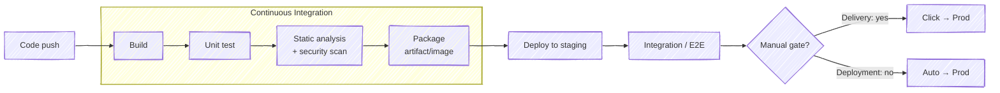
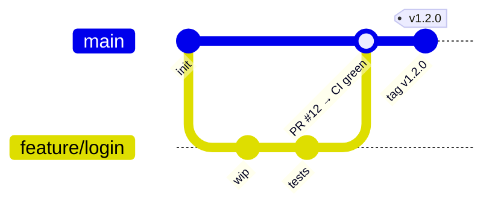

# 01 · CI/CD Fundamentals

> **Goal:** know what CI, CD and CD mean, what a pipeline is made of, and how good teams measure delivery.

[← README](../README.md) · [Next: Architecture →](02-architecture.md)

---

## 1. The three terms

| Term | Means | Ends with |
|------|-------|-----------|
| **Continuous Integration** | Every push gets built and tested automatically. Merge to main often (daily+). | A tested artifact |
| **Continuous Delivery** | Every green build is *deployable*. Prod deploy is one manual click. | Artifact ready for prod |
| **Continuous Deployment** | Every green build goes to prod automatically. No human gate. | Running in prod |

---

## 2. Pipeline anatomy

| Piece | What it is |
|-------|------------|
| **Trigger** | What starts it: push, PR, webhook, cron, upstream job, manual |
| **Stage** | Logical phase (Build, Test, Scan, Deploy) |
| **Step** | One command/action inside a stage |
| **Agent / Runner** | Machine/container that runs steps |
| **Artifact** | Output kept after the run (jar, image, report) |
| **Gate** | Pass/fail check that blocks promotion (tests, quality gate, approval) |
| **Environment** | Where it deploys (dev, staging, prod) |

### Golden rules
1. **Build once, deploy many.** Same artifact (same digest) goes dev → staging → prod. Only config changes.
2. **Fail fast.** Cheap checks first (lint, unit) → expensive later (E2E, DAST).
3. **Pipeline as code.** Pipeline lives in repo (`Jenkinsfile`), reviewed like code.
4. **Immutable artifacts.** Never overwrite a tag. Version = git SHA or semver.
5. **Ephemeral agents.** Clean environment every build. No snowflake build servers.
6. **Everything reproducible.** Pin tool versions, base images, plugins.
7. **Secrets never in code or logs.**

---

## 3. Branching models (affects pipeline design)

| Model | How | Pipeline impact |
|-------|-----|-----------------|
| **Trunk-based** | Short-lived branches (<1 day), merge to `main`, feature flags hide unfinished work | One main pipeline; ⭐ needed for real CI |
| **GitHub Flow** | Feature branch → PR → main → deploy | PR builds + main deploys |
| **GitFlow** | `develop`, `release/*`, `hotfix/*`, `main` | Many branch-specific pipelines; heavy, old-school |
| **Release branches** | Cut `release/1.4` for stabilization | Build per release branch |

---

## 4. Versioning artifacts

| Scheme | Example | Use |
|--------|---------|-----|
| SemVer | `1.4.2` (MAJOR.MINOR.PATCH) | Libraries, releases |
| Git SHA | `a1b2c3d` | Every build, traceable |
| Combo | `1.4.2-a1b2c3d` / `1.4.2-build.57` | ⭐ Images |
| CalVer | `2026.10.1` | Products with time-based releases |

Never deploy `:latest` to prod. Prefer pinning by **digest** (`image@sha256:...`).

---

## 5. Measuring delivery — DORA metrics

| Metric | Question | Elite |
|--------|----------|-------|
| **Deployment frequency** | How often do we deploy to prod? | On demand, many/day |
| **Lead time for changes** | Commit → running in prod? | < 1 day |
| **Change failure rate** | % deploys causing incident/rollback | ~0–15% |
| **Failed deployment recovery time** (was MTTR) | How fast do we recover? | < 1 hour |

Plus **reliability** (5th, added later). Speed metrics (first two) and stability metrics (last two) move *together* in good teams.

---

## 6. CI/CD tool landscape (one line each)

| Tool | Type |
|------|------|
| **Jenkins** | Self-hosted, plugin-based automation server. Most flexible, most ops burden. |
| GitHub Actions | SaaS CI tied to GitHub; YAML workflows; marketplace actions |
| GitLab CI | Built into GitLab; `.gitlab-ci.yml`; runners |
| CircleCI / Travis / Buildkite | SaaS CI (Buildkite = SaaS control plane + your agents) |
| Tekton | K8s-native CI building blocks (CRDs) |
| Argo CD / Flux | GitOps CD — pull-based deploy to K8s |
| Spinnaker | Multi-cloud CD with advanced deploy strategies |
| Azure DevOps / AWS CodePipeline | Cloud-vendor CI/CD |

Full comparison: [22 · Jenkins vs others](22-jenkins-vs-others.md).

---

## 7. Interview one-liners

- **CI vs CD?** CI = integrate + test every change. CD = always releasable (delivery) / auto-release (deployment).
- **Why build once?** Rebuilding per env can produce a different binary → you test one thing and ship another.
- **What makes a good pipeline?** Fast (<10 min feedback), deterministic, as-code, secure, observable, fails loudly.
- **Flaky test?** Passes/fails without code change. Quarantine, fix, never just retry forever.
- **Shift left?** Move testing/security earlier in the pipeline where fixing is cheaper.
