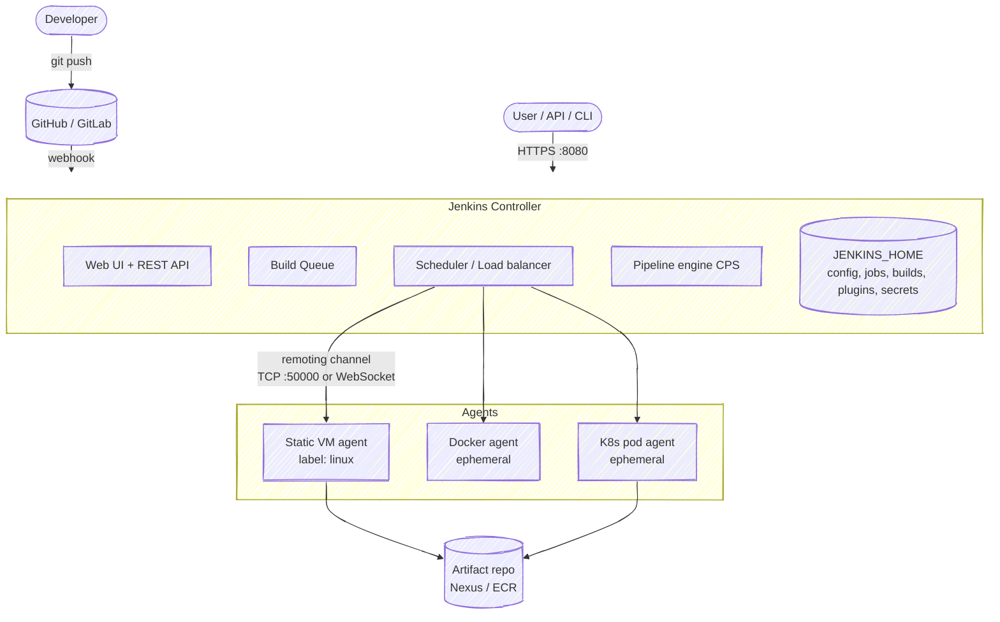
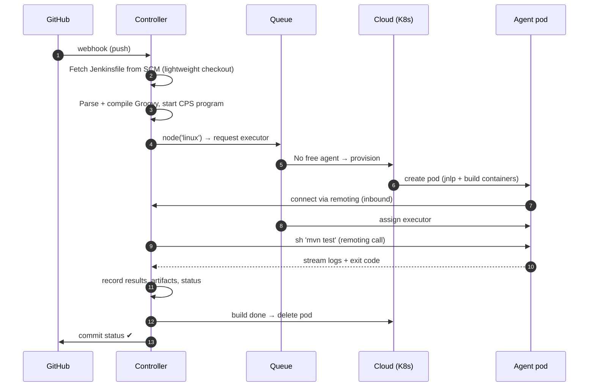

# 02 · Jenkins Architecture

> **Goal:** explain controller, agents, executors, remoting, JENKINS_HOME and how a build actually runs.

[← CI/CD Fundamentals](01-cicd-fundamentals.md) · [Next: Installation →](03-installation.md)

---

## 1. What Jenkins is

Open-source automation server, Java (runs on JVM as a WAR on embedded Jetty). Everything beyond core = **plugins** (~2000). Started as **Hudson** (Sun, 2004) → forked to Jenkins 2011 after Oracle dispute. Jenkins 2.0 (2016) made **Pipeline as code** first-class.

Release lines:
- **Weekly** — new features every week.
- **LTS** — every 12 weeks, picked from a weekly, backported fixes. ⭐ Use LTS in prod.

---

## 2. Big picture



---

## 3. Core components

| Component | What it does |
|-----------|--------------|
| **Controller** (old name: master) | Hosts UI/API, stores config, schedules builds, runs pipeline logic (Groovy CPS), holds credentials. **Should NOT run builds.** |
| **Agent** (old: slave) | Machine/container that runs build steps. Connects to controller via **remoting**. |
| **Node** | Generic term: controller or agent. "Built-In Node" = controller itself. |
| **Executor** | A slot on a node that runs one build at a time. 4 executors = 4 parallel builds. |
| **Label** | Tag on an agent (`linux`, `docker`, `gpu`). Jobs request labels, not machines. |
| **Workspace** | Directory on agent where the job checks out code and builds. |
| **Queue** | Builds waiting for a free executor matching their label. |
| **Cloud** | Plugin that provisions agents on demand (Kubernetes, EC2, Docker, Azure VM). |
| **Plugin** | `.jpi/.hpi` file extending Jenkins. Lives in `$JENKINS_HOME/plugins`. |

**Set built-in node executors = 0** in prod. Builds on controller can read `JENKINS_HOME` (secrets!) and steal controller CPU/memory.

---

## 4. How a build runs (pipeline)



Key insight: **Pipeline Groovy runs on the controller.** Only steps like `sh`, `bat`, `checkout`, file operations run on the agent. Heavy Groovy logic (JSON parsing loops, etc.) burns controller CPU — keep it in `sh` scripts.

---

## 5. Remoting & agent connection

| Mode | Direction | Use when |
|------|-----------|----------|
| **SSH (outbound)** | Controller → agent over SSH (`SSH Build Agents` plugin) | Static Linux VMs reachable from controller |
| **Inbound / JNLP** | Agent → controller TCP **50000** | Agent behind NAT/firewall; K8s pods (default) |
| **Inbound WebSocket** | Agent → controller over HTTPS **443** | No extra port; through ingress/LB ⭐ |
| **Cloud plugins** | Controller asks cloud API to create agent, agent connects inbound | Ephemeral, autoscaling |

Agent runs `agent.jar` (remoting). Needs **Java** on agent (same major version as controller recommended).

---

## 6. JENKINS_HOME layout

Default: `/var/jenkins_home` (Docker) or `/var/lib/jenkins` (package).

```text
$JENKINS_HOME/
├── config.xml                 # global config (security, views, clouds)
├── *.xml                      # plugin/global settings (one file per component)
├── credentials.xml            # encrypted credentials (system store)
├── secrets/
│   ├── master.key             # decrypts hudson.util.Secret  ← protect!
│   ├── hudson.util.Secret
│   └── initialAdminPassword   # first-boot unlock password
├── jobs/<job>/
│   ├── config.xml             # job definition
│   ├── nextBuildNumber
│   └── builds/<n>/            # log, build.xml, archived artifacts
├── workspace/                 # workspaces for builds on built-in node
├── plugins/                   # *.jpi + exploded dirs
├── nodes/                     # agent definitions
├── users/                     # user accounts, API tokens
├── fingerprints/              # artifact MD5 tracking
└── logs/
```

- Everything is **XML files on disk** — no database.
- Backup minimum: `config.xml`, `*.xml`, `jobs/*/config.xml`, `users/`, `secrets/`, `plugins` list, `nodes/`.
- Lose `secrets/master.key` → all stored credentials are unreadable.

---

## 7. Job types

| Type | Defined by | Use |
|------|------------|-----|
| **Freestyle** | UI forms | Legacy, simple tasks. Avoid for new work. |
| **Pipeline** | `Jenkinsfile` (inline or SCM) | One pipeline, one branch |
| **Multibranch Pipeline** | Repo; auto-creates a job per branch/PR with a `Jenkinsfile` | ⭐ Standard for app repos |
| **Organization Folder** | GitHub org / Bitbucket team; auto-creates multibranch per repo | ⭐ Platform-scale |
| **Folder** | Container for jobs; scope for credentials + permissions | Multi-team isolation |
| **Matrix (multi-config)** | Freestyle axes | Legacy; use pipeline `matrix` |

Details: [04 · Jobs & Builds](04-jobs-and-builds.md).

---

## 8. Controller sizing (rule of thumb)

| Scale | Controller | Notes |
|-------|-----------|-------|
| Small (≤50 jobs) | 2 vCPU, 4 GB RAM, heap 2 GB | |
| Medium (≤500 jobs) | 4 vCPU, 8–16 GB, heap 4–8 GB | Fast SSD for `JENKINS_HOME` |
| Large | Split into **multiple controllers** per team/domain | One controller doesn't scale horizontally |

JVM: G1GC (default on Java 17/21), heap 50–70% of container memory, `-XX:+UseContainerSupport` (default). Disk IO is the usual bottleneck.

---

## 9. Interview one-liners

- **Controller vs agent?** Controller orchestrates + stores state; agents execute.
- **Why 0 executors on controller?** Security (access to secrets/JENKINS_HOME) + stability.
- **Where does Groovy run?** On controller (CPS). `sh` runs on agent.
- **Is Jenkins HA?** OSS = single active controller. Scale out with more controllers + ephemeral agents. Active/passive via shared storage possible; true HA = CloudBees CI.
- **Port 50000?** Inbound TCP agent port. WebSocket avoids it.
- **Where is config stored?** XML files in `JENKINS_HOME`. No DB.
