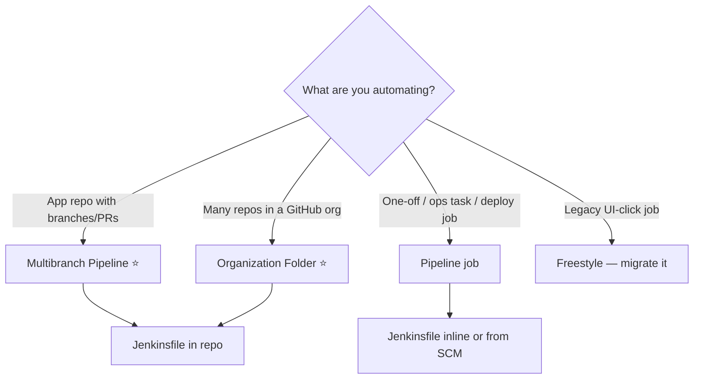
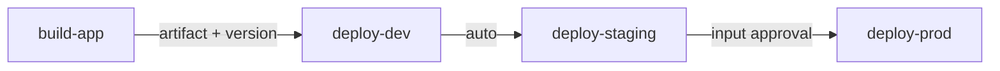

# 04 · Jobs, Builds, Triggers, Parameters

> **Goal:** pick the right job type, trigger it correctly, parameterize it, and know build states.

[← Installation](03-installation.md) · [Next: Declarative Pipeline →](05-pipeline-declarative.md)

---

## 1. Job types — decision



| Type | Key facts |
|------|-----------|
| **Freestyle** | UI-configured build steps + post-build actions. Not versioned. No stages. |
| **Pipeline** | `Pipeline script` (inline) or `Pipeline script from SCM`. Survives controller restarts. |
| **Multibranch** | Scans repo → one child job per branch/PR/tag containing a `Jenkinsfile`. Deletes jobs when branch is gone (orphan strategy). |
| **Organization Folder** | Scans org → multibranch per repo. Zero per-repo setup. |
| **Folder** | Groups jobs; own credentials, permissions, shared libraries. |

### Multibranch discovery settings (GitHub Branch Source)
- **Discover branches**: exclude branches that are also PRs (avoids double builds).
- **Discover PRs from origin**: merge with target (tests merge result) or head.
- **Discover PRs from forks**: trust = *From users with Admin or Write permission* (forks can't modify `Jenkinsfile` to steal secrets otherwise).
- **Discover tags**: tags are discovered but **not built automatically** by default (add "Build Strategies" plugin).
- **Scan triggers**: webhook preferred; periodic scan (e.g. 1 day) as safety net.

Env vars in multibranch: `BRANCH_NAME`, `CHANGE_ID` (PR number), `CHANGE_TARGET`, `CHANGE_BRANCH`, `CHANGE_AUTHOR`, `TAG_NAME`.

---

## 2. Triggers

| Trigger | How | Notes |
|---------|-----|-------|
| **Webhook** | SCM POSTs to Jenkins | ⭐ Instant, cheap |
| **Poll SCM** | `pollSCM('H/5 * * * *')` | Jenkins asks git periodically. Wasteful; fallback only |
| **Cron** | `cron('H 2 * * *')` | Nightly jobs, scans |
| **Upstream** | `upstream(upstreamProjects: 'lib-build', threshold: hudson.model.Result.SUCCESS)` | Chain jobs |
| **Build step** | `build job: 'deploy', parameters: [...]` | Trigger another job from pipeline |
| **Remote API** | `POST /job/x/build?token=...` or with API token | Scripts, other systems |
| **Generic Webhook Trigger** | Plugin; parses any JSON payload into vars | Non-standard webhook sources |
| **Manual** | "Build Now" | |

### Webhook URLs

| Source | URL |
|--------|-----|
| GitHub plugin | `https://jenkins/github-webhook/` |
| GitLab plugin | `https://jenkins/project/<job-path>` |
| Bitbucket | `https://jenkins/bitbucket-hook/` (plugin dependent) |
| Generic Webhook Trigger | `https://jenkins/generic-webhook-trigger/invoke?token=<t>` |
| Multibranch scan trigger | `https://jenkins/multibranch-webhook-trigger/invoke?token=<t>` |

Trailing slash matters on `/github-webhook/`.

---

## 3. Cron syntax + `H`

```text
MINUTE HOUR DOM MONTH DOW
H      2    *   *     1-5     # weekdays at 02:xx
H/15   *    *   *     *       # every 15 min, offset per job
H(0-29) 9   *   *     *       # once between 9:00–9:29
@midnight / @daily / @hourly  # aliases (also hashed)
```

**`H` = hash of job name** → spreads load so 100 jobs don't all start at :00. Always use `H` instead of `0`.

---

## 4. Parameters

```groovy
parameters {
  string(name: 'VERSION', defaultValue: '1.0.0', description: 'Release version')
  choice(name: 'ENV', choices: ['dev', 'staging', 'prod'], description: 'Target')
  booleanParam(name: 'SKIP_TESTS', defaultValue: false)
  text(name: 'NOTES', defaultValue: '')
  password(name: 'TEMP_PASS', defaultValue: '')    // prefer credentials
  credentials(name: 'DEPLOY_KEY', credentialType: 'com.cloudbees.plugins.credentials.impl.UsernamePasswordCredentialsImpl', required: true)
}
// usage: params.ENV, "${params.VERSION}"
```

- Parameters defined in `Jenkinsfile` appear **after the first run** (first run uses defaults).
- **Active Choices** plugin = dynamic/cascading dropdowns (Groovy-scripted).
- `params` are read-only; `env` vars are strings.

---

## 5. Build results

| Result | Meaning | Color |
|--------|---------|-------|
| `SUCCESS` | All good | Blue/green |
| `UNSTABLE` | Built, but tests failed / quality warnings (`junit` with failures, `unstable()`) | Yellow |
| `FAILURE` | Step failed (non-zero exit, `error()`) | Red |
| `ABORTED` | Manually stopped / timeout / superseded | Grey |
| `NOT_BUILT` | Stage skipped / never ran | Grey |

Order of severity: SUCCESS < UNSTABLE < FAILURE < NOT_BUILT < ABORTED — overall result only gets worse, never better (`currentBuild.result`).

---

## 6. Build history & retention

```groovy
options { buildDiscarder(logRotator(numToKeepStr: '30', artifactNumToKeepStr: '5', daysToKeepStr: '30')) }
```

Without retention, `JENKINS_HOME` fills disk. Global default possible via JCasC / "Discard Old Builds" for multibranch (orphaned item strategy).

---

## 7. Useful build features

| Feature | What |
|---------|------|
| **Replay** | Re-run a pipeline build with edited Groovy (no commit). Debug only. |
| **Restart from Stage** | Declarative only; re-run from a stage using stashes from previous run (`preserveStashes`). |
| **Rebuild** | Plugin; rerun with same params. |
| **Build with Parameters** | Manual with inputs. |
| **Blue Ocean** | Old modern UI. Deprecated-ish / not maintained; use classic UI + Pipeline Graph View plugin. |
| **Pipeline Graph View** | ⭐ Modern stage view in classic UI. |
| **Fingerprints** | MD5 tracking of artifacts across jobs ("which build produced this jar?"). |
| **Quiet period** | Delay start to batch commits. |
| **Throttle Concurrent Builds** | Limit parallel runs per job/category. |
| **Lockable Resources** | `lock('staging-env') { ... }` — mutex across jobs. |

---

## 8. Job chaining patterns



```groovy
// call downstream job, wait, and get its result
def r = build job: 'deploy', wait: true, propagate: false,
        parameters: [string(name: 'VERSION', value: env.VERSION), string(name: 'ENV', value: 'staging')]
echo "Downstream: ${r.result} #${r.number}"
```

Prefer one pipeline with stages + `input` over long chains of jobs (easier to trace). Use separate deploy jobs when deploy needs different permissions/agents.
