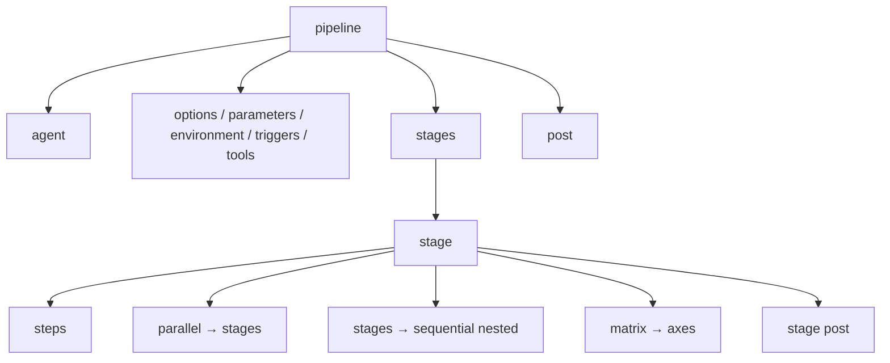

# 05 · Declarative Pipeline (every directive)

> **Goal:** write any declarative `Jenkinsfile` from memory. Every directive, every `post` condition, every `when` option.

[← Jobs & Builds](04-jobs-and-builds.md) · [Next: Scripted & Groovy →](06-pipeline-scripted-groovy.md)

---

## 1. Skeleton

```groovy
pipeline {
  agent any                        // where (required at top or per stage)
  options { ... }                  // job behaviour
  parameters { ... }               // build inputs
  environment { ... }              // env vars
  triggers { ... }                 // auto start
  tools { ... }                    // auto-installed tools
  stages {
    stage('Build') {
      agent { ... }                // optional per-stage agent
      when { ... }                 // conditional
      environment { ... }
      options { ... }
      input { ... }                // pause for approval
      steps { ... }                // OR parallel { } OR stages { } OR matrix { }
      post { ... }
    }
  }
  post { ... }                     // after all stages
}
```



---

## 2. `agent`

```groovy
agent any                                  // any available executor
agent none                                 // top-level: each stage declares own agent
agent { label 'linux && docker' }          // label expression (&&, ||, !)
agent { node { label 'linux'; customWorkspace '/ws/app' } }
agent {
  docker {
    image 'maven:3.9-eclipse-temurin-21'
    args  '-v $HOME/.m2:/root/.m2'         // cache
    label 'docker'
    reuseNode true                         // reuse top-level node/workspace
    registryUrl 'https://registry.example.com'
    registryCredentialsId 'reg-creds'
  }
}
agent { dockerfile { filename 'Dockerfile.ci'; dir 'ci'; additionalBuildArgs '--pull' } }
agent {
  kubernetes {
    yamlFile 'ci/pod.yaml'                 // or inline yaml '''...'''
    defaultContainer 'maven'
  }
}
```

`agent none` at top + agent per stage = don't hold an executor while waiting on `input`.

---

## 3. `options`

```groovy
options {
  timeout(time: 30, unit: 'MINUTES')                 // kill hung builds
  buildDiscarder(logRotator(numToKeepStr: '20'))
  disableConcurrentBuilds(abortPrevious: true)       // new push aborts older run
  timestamps()                                       // timestamp each log line
  ansiColor('xterm')                                 // colored logs (plugin)
  retry(2)                                           // whole pipeline retry
  skipDefaultCheckout()                              // no auto checkout scm
  skipStagesAfterUnstable()
  parallelsAlwaysFailFast()
  preserveStashes(buildCount: 5)                     // for restart-from-stage
  quietPeriod(10)
  checkoutToSubdirectory('src')
  durabilityHint('PERFORMANCE_OPTIMIZED')            // fewer disk writes
  newContainerPerStage()                             // with docker/k8s agent
}
```

Stage-level options: `timeout`, `retry`, `timestamps`, `skipDefaultCheckout`.

---

## 4. `environment` & credentials

```groovy
environment {
  APP      = 'payments-api'
  VERSION  = "1.0.${BUILD_NUMBER}"
  GIT_SHORT = sh(script: 'git rev-parse --short HEAD', returnStdout: true).trim()  // runs on agent
  REG      = credentials('registry-creds')   // user/pass → REG, REG_USR, REG_PSW
  TOKEN    = credentials('sonar-token')      // secret text → TOKEN
  KUBECFG  = credentials('kubeconfig-file')  // secret file → path to temp file
}
```

| Credential type | `credentials()` gives |
|-----------------|-----------------------|
| Secret text | `VAR` = value |
| Username/password | `VAR` = `user:pass`, `VAR_USR`, `VAR_PSW` |
| Secret file | `VAR` = path to temp file |
| SSH key | `VAR` = key file path, `VAR_USR` (+ `VAR_PSW` passphrase) |

---

## 5. `parameters`, `triggers`, `tools`

```groovy
parameters {
  choice(name: 'ENV', choices: ['dev','staging','prod'])
  booleanParam(name: 'DRY_RUN', defaultValue: true)
  string(name: 'TAG', defaultValue: '')
}
triggers {
  pollSCM('H/5 * * * *')
  cron('H 3 * * 1-5')
  upstream(upstreamProjects: 'common-lib/main', threshold: hudson.model.Result.SUCCESS)
  // githubPush()  — when using GitHub plugin with non-multibranch pipeline
}
tools {
  maven 'maven-3.9'          // names from Manage → Tools
  jdk   'temurin-21'
  nodejs 'node-20'
}
```

Prefer container images over `tools` — versions pinned in code, nothing installed on agents.

---

## 6. `when` (conditional stages)

```groovy
when { branch 'main' }                                   // glob: 'release/*'
when { branch pattern: 'release-\\d+', comparator: 'REGEXP' }
when { buildingTag() }
when { tag 'v*' }
when { changeRequest() }                                 // is a PR
when { changeRequest target: 'main' }
when { environment name: 'ENV', value: 'prod' }
when { expression { params.DRY_RUN == false } }
when { changeset 'services/payments/**' }                // monorepo: path changed
when { triggeredBy 'TimerTrigger' }                      // cron
when { triggeredBy cause: 'UserIdCause' }                // manual
when { equals expected: 2, actual: currentBuild.number }
when {
  allOf { branch 'main'; not { changeRequest() } }
  // anyOf { ... }  not { ... }
}
when { beforeAgent true; branch 'main' }                 // evaluate before allocating agent ⭐
when { beforeInput true; ... }                           // evaluate before input
when { beforeOptions true; ... }
```

Skipped stage = shown as skipped, result `NOT_BUILT` for that stage.

---

## 7. `input` (approval gate)

```groovy
stage('Deploy prod') {
  agent none                    // don't hold executor while waiting
  options { timeout(time: 1, unit: 'HOURS') }
  input {
    message 'Deploy to prod?'
    ok 'Ship it'
    submitter 'release-managers,alice'   // users/groups allowed
    submitterParameter 'APPROVER'        // who approved → env var
    parameters { string(name: 'CHANGE_TICKET', defaultValue: '') }
  }
  steps { echo "Approved by ${APPROVER}, ticket ${CHANGE_TICKET}" }
}
```

---

## 8. `parallel`, nested `stages`, `matrix`

```groovy
stage('Checks') {
  failFast true
  parallel {
    stage('Unit')  { steps { sh 'make test' } }
    stage('Lint')  { steps { sh 'make lint' } }
    stage('SAST')  { agent { label 'sonar' }; steps { sh 'make sonar' } }
  }
}

stage('Sequential group') {
  stages {
    stage('A') { steps { echo 'a' } }
    stage('B') { steps { echo 'b' } }
  }
}

stage('Test matrix') {
  matrix {
    axes {
      axis { name 'OS';   values 'linux', 'windows' }
      axis { name 'JAVA'; values '17', '21' }
    }
    excludes {
      exclude { axis { name 'OS'; values 'windows' }; axis { name 'JAVA'; values '17' } }
    }
    agent { label "${OS}" }
    stages {
      stage('Test') { steps { echo "OS=${OS} JAVA=${JAVA}" } }
    }
  }
}
```

---

## 9. `post` conditions

| Condition | Runs when |
|-----------|-----------|
| `always` | Always |
| `success` | Current result SUCCESS |
| `failure` | FAILURE |
| `unstable` | UNSTABLE |
| `aborted` | ABORTED |
| `unsuccessful` | Not SUCCESS |
| `changed` | Result differs from previous build |
| `fixed` | Previous failed/unstable, now success |
| `regression` | Previous success, now failure/unstable/aborted |
| `cleanup` | After all other post conditions, always ⭐ cleanup here |

Order: `always → changed → fixed → regression → aborted → failure → success → unstable → unsuccessful → cleanup`.

```groovy
post {
  always   { junit allowEmptyResults: true, testResults: '**/target/surefire-reports/*.xml' }
  failure  { slackSend channel: '#ci', color: 'danger', message: "❌ ${env.JOB_NAME} #${env.BUILD_NUMBER} ${env.BUILD_URL}" }
  fixed    { slackSend channel: '#ci', color: 'good', message: "✅ fixed ${env.JOB_NAME}" }
  cleanup  { cleanWs() }
}
```

---

## 10. `script {}` escape hatch

Declarative allows only steps inside `steps`. For loops, variables, try/catch → `script { }`.

```groovy
steps {
  script {
    def services = ['api', 'worker']
    services.each { svc -> sh "make build SVC=${svc}" }
    env.IMAGE_TAG = "${env.GIT_COMMIT.take(7)}"   // set env var for later stages
  }
}
```

If `script` blocks grow big → move logic to a **shared library** ([07](07-shared-libraries.md)).

---

## 11. Most-used steps

| Step | Example |
|------|---------|
| `sh` | `sh 'make test'` · `def out = sh(script: 'git rev-parse HEAD', returnStdout: true).trim()` · `def rc = sh(script: 'x', returnStatus: true)` |
| `checkout scm` | Checkout the commit that triggered build |
| `git` | `git url: '...', branch: 'main', credentialsId: 'gh'` |
| `echo` / `error` | `error 'stop here'` fails build |
| `unstable` / `warnError` / `catchError` | `catchError(buildResult: 'SUCCESS', stageResult: 'FAILURE') { sh 'flaky' }` |
| `retry` / `timeout` / `sleep` / `waitUntil` | `retry(3) { sh 'curl ...' }` |
| `stash` / `unstash` | Move files between agents (small files only) |
| `archiveArtifacts` | `archiveArtifacts artifacts: 'build/*.jar', fingerprint: true` |
| `junit` | Publish test results (sets UNSTABLE on failures) |
| `withCredentials` | Scoped secret binding |
| `withEnv` | `withEnv(['FOO=bar']) { sh 'echo $FOO' }` |
| `dir` | `dir('frontend') { sh 'npm ci' }` |
| `readFile` / `writeFile` / `fileExists` | File ops on agent |
| `readJSON` / `readYaml` / `writeJSON` | Pipeline Utility Steps plugin |
| `build` | Trigger another job |
| `input` | Pause for approval |
| `lock` | Lockable Resources |
| `milestone` | Older builds can't pass a milestone after a newer one did |
| `cleanWs` / `deleteDir` | Clean workspace |
| `emailext` / `slackSend` | Notifications |

---

## 12. Built-in env vars (most asked)

`BUILD_NUMBER`, `BUILD_ID`, `BUILD_URL`, `JOB_NAME`, `JOB_BASE_NAME`, `WORKSPACE`, `JENKINS_URL`, `NODE_NAME`, `EXECUTOR_NUMBER`, `GIT_COMMIT`, `GIT_BRANCH`, `GIT_URL`, `BRANCH_NAME`, `CHANGE_ID`, `TAG_NAME`, `BUILD_TAG` (`jenkins-${JOB_NAME}-${BUILD_NUMBER}`).

Full list on any Jenkins: `https://<jenkins>/env-vars.html`. Snippet generator: `<job>/pipeline-syntax`. Directive generator: `<job>/directive-generator`.

---

## 13. Complete example

```groovy
pipeline {
  agent { kubernetes { yamlFile 'ci/pod.yaml'; defaultContainer 'build' } }
  options {
    timeout(time: 30, unit: 'MINUTES')
    disableConcurrentBuilds(abortPrevious: true)
    buildDiscarder(logRotator(numToKeepStr: '30'))
    timestamps()
  }
  environment {
    IMAGE = "registry.example.com/team/api"
    TAG   = "${env.GIT_COMMIT?.take(7) ?: env.BUILD_NUMBER}"
  }
  stages {
    stage('Build & Unit') {
      steps { sh 'make build test' }
      post  { always { junit 'reports/**/*.xml' } }
    }
    stage('Scan') {
      parallel {
        stage('Sonar') { steps { withSonarQubeEnv('sonar') { sh 'make sonar' } } }
        stage('Deps')  { steps { sh 'trivy fs --exit-code 1 --severity CRITICAL .' } }
      }
    }
    stage('Image') {
      when { branch 'main' }
      steps {
        container('kaniko') {
          sh '/kaniko/executor --context . --destination ${IMAGE}:${TAG}'
        }
      }
    }
    stage('Deploy staging') {
      when { beforeAgent true; branch 'main' }
      steps { sh './deploy.sh staging ${TAG}' }
    }
  }
  post {
    failure { slackSend channel: '#ci', message: "❌ ${JOB_NAME} #${BUILD_NUMBER}" }
    cleanup { cleanWs() }
  }
}
```
