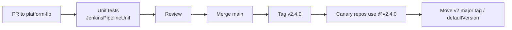

# 07 · Shared Libraries

> **Goal:** stop copy-pasting Jenkinsfiles. Build a versioned, tested library every repo calls in 5 lines.

[← Scripted & Groovy](06-pipeline-scripted-groovy.md) · [Next: Agents →](08-agents-distributed-builds.md)

---

## 1. Why

100 repos × 200-line Jenkinsfile = 100 places to fix one bug. A **shared library** = Git repo of Groovy code loaded into pipelines. Platform team owns the "golden path"; app teams write:

```groovy
@Library('platform-lib@v2') _
goldenPipeline(language: 'java', deploy: true)
```

---

## 2. Structure

```text
platform-lib/
├── vars/                        # global steps: callable as functions
│   ├── goldenPipeline.groovy    # → goldenPipeline(...)
│   ├── goldenPipeline.txt       # help text shown in Pipeline Syntax
│   ├── buildImage.groovy
│   └── notifySlack.groovy
├── src/                         # Groovy classes (package dirs)
│   └── org/acme/ci/
│       ├── Docker.groovy
│       └── Semver.groovy
├── resources/                   # non-Groovy files
│   └── org/acme/ci/pod-java.yaml
└── test/                        # unit tests (JenkinsPipelineUnit / Spock)
```

| Dir | Contains | Accessed via |
|-----|----------|--------------|
| `vars/` | `foo.groovy` with `def call(...)` | `foo(...)` in pipeline; also `foo.otherMethod()` |
| `src/` | Classes | `import org.acme.ci.Docker` |
| `resources/` | YAML, scripts, templates | `libraryResource 'org/acme/ci/pod-java.yaml'` |

---

## 3. Register the library

**Manage Jenkins → System → Global Trusted Pipeline Libraries** (or folder → Pipeline Libraries) — or JCasC:

```yaml
unclassified:
  globalLibraries:
    libraries:
      - name: platform-lib
        defaultVersion: v2           # branch, tag or SHA
        implicit: false              # true = auto-loaded, no @Library needed
        allowVersionOverride: true   # allow @Library('platform-lib@feature-x')
        includeInChangesets: false   # don't trigger builds on lib commits
        retriever:
          modernSCM:
            scm:
              git:
                remote: https://github.com/acme/platform-lib.git
                credentialsId: github-app
```

| Level | Trust | Sandbox |
|-------|-------|---------|
| Global | Trusted | ❌ runs unsandboxed (can call any Java API) |
| Folder | Untrusted | ✅ sandboxed |

**Protect the global library repo** (branch protection + reviews) — anyone who can push to it can run code on the controller.

---

## 4. Loading syntax

```groovy
@Library('platform-lib') _                   // default version; `_` = annotate nothing
@Library('platform-lib@v2.3.1') _            // pinned tag ⭐
@Library(['platform-lib@v2', 'other-lib']) _
@Library('platform-lib') import org.acme.ci.Semver

library 'platform-lib@v2'                    // dynamic, at runtime (no src/ classes at compile time)
def lib = library('platform-lib@v2').org.acme.ci
```

---

## 5. `vars/` examples

**Simple step** `vars/notifySlack.groovy`:

```groovy
def call(String status, String channel = '#ci') {
  def color = status == 'SUCCESS' ? 'good' : 'danger'
  slackSend(channel: channel, color: color,
            message: "${status}: ${env.JOB_NAME} #${env.BUILD_NUMBER} (<${env.BUILD_URL}|open>)")
}
```

**Whole pipeline as a step** `vars/goldenPipeline.groovy`:

```groovy
def call(Map cfg = [:]) {
  def lang   = cfg.get('language', 'java')
  def deploy = cfg.get('deploy', false)

  pipeline {
    agent { kubernetes { yaml libraryResource("org/acme/ci/pod-${lang}.yaml"); defaultContainer 'build' } }
    options { timeout(time: 45, unit: 'MINUTES'); timestamps(); disableConcurrentBuilds(abortPrevious: true) }
    stages {
      stage('Build')  { steps { sh "make build" } }
      stage('Test')   { steps { sh "make test" }; post { always { junit allowEmptyResults: true, testResults: '**/reports/*.xml' } } }
      stage('Scan')   { steps { securityScan() } }
      stage('Image')  { when { branch 'main' }; steps { buildImage(name: cfg.image ?: env.JOB_NAME.tokenize('/')[1]) } }
      stage('Deploy') { when { allOf { branch 'main'; expression { deploy } } }; steps { gitopsPromote(env: 'staging') } }
    }
    post { always { notifySlack(currentBuild.currentResult) } }
  }
}
```

A declarative `pipeline {}` block inside a `vars/` `call()` is allowed — this is the standard golden-path pattern.

**Class in `src/`** `src/org/acme/ci/Semver.groovy`:

```groovy
package org.acme.ci

class Semver implements Serializable {        // Serializable — CPS requirement
  String version
  Semver(String v) { version = v }
  String bumpPatch() {
    def (maj, min, pat) = version.tokenize('.')*.toInteger()
    return "${maj}.${min}.${pat + 1}"
  }
}
```

Classes that call steps need the script context: pass `this` (`new Docker(this).build()`, inside class `steps.sh '...'`).

---

## 6. Versioning & release



- Tag releases with semver. Consumers pin major (`@v2`) or exact.
- Breaking change → new major. Keep `v1` alive while teams migrate.
- Test with `@Library('platform-lib@my-branch')` in a sandbox job before merge.

---

## 7. Testing

- **JenkinsPipelineUnit** — run pipeline Groovy in JUnit, mock steps, assert call stack.
- **Jenkinsfile Runner** — run a real Jenkins headless in a container for integration tests.
- Lint declarative: `curl -X POST -F "jenkinsfile=<Jenkinsfile" $JENKINS_URL/pipeline-model-converter/validate` (with auth/crumb).

---

## 8. Gotchas

- `src/` classes must be **Serializable** or annotate methods `@NonCPS`.
- Steps (`sh`, `echo`) aren't available inside classes unless you pass the script object.
- Changing `vars/` signature breaks every consumer → version it.
- `libraryResource` reads from library, not from app repo.
- Global lib = trusted → code review it like production infrastructure code.
