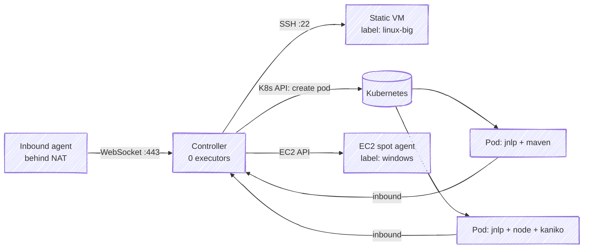

# 08 · Agents & Distributed Builds

> **Goal:** connect any agent type, run builds in Docker and Kubernetes pods, autoscale, and pick static vs ephemeral.

[← Shared Libraries](07-shared-libraries.md) · [Next: Credentials →](09-credentials-secrets.md)

---

## 1. Agent types

| Type | Lifecycle | Pros | Cons |
|------|-----------|------|------|
| **Static VM (SSH)** | Always on | Simple, warm caches | Drift, idle cost, snowflakes |
| **Static inbound (JNLP/WebSocket)** | Always on, agent dials in | Works behind NAT | Same drift |
| **Docker agent** (`agent { docker }`) | Container per build on a Docker host | Clean env, pinned tools | Needs Docker host |
| **Kubernetes pod** | Pod per build, deleted after | ⭐ Elastic, isolated, multi-container | Cold start, cache needs work |
| **Cloud VM** (EC2 / Azure VM / GCE plugins) | VM per build/idle timeout | Full VM (Docker-in-VM, Windows) | Slow start |



---

## 2. Static SSH agent (setup)

1. On agent: Java 17/21, user `jenkins`, workspace dir `/home/jenkins/agent`.
2. Add controller's public key to agent `~/.ssh/authorized_keys`.
3. Credential: **SSH Username with private key** (id `agent-ssh`).
4. Manage Jenkins → Nodes → New Node → Permanent:
   - Remote root dir `/home/jenkins/agent`, labels `linux docker`, executors = CPU cores-ish
   - Launch: *Launch agents via SSH*, host key verification = **Known hosts** (not "Non verifying").
5. Usage: *Only build jobs with label expressions matching this node* (keeps random jobs off).

## 3. Inbound agent

```bash
# Node created as "Launch agent by connecting it to the controller"
curl -sO https://jenkins.example.com/jnlpJars/agent.jar
java -jar agent.jar -url https://jenkins.example.com/ \
  -secret @secret-file -name "build-01" -webSocket -workDir /home/jenkins/agent
```

Or container: `jenkins/inbound-agent` image with env `JENKINS_URL`, `JENKINS_SECRET`, `JENKINS_AGENT_NAME`, `JENKINS_WEB_SOCKET=true`.

---

## 4. Docker agents

```groovy
pipeline {
  agent none
  stages {
    stage('Backend') {
      agent { docker { image 'maven:3.9-eclipse-temurin-21'; args '-v m2:/root/.m2' } }
      steps { sh 'mvn -B verify' }
    }
    stage('Frontend') {
      agent { docker { image 'node:20-alpine' } }
      steps { sh 'npm ci && npm test' }
    }
  }
}
```

- Needs **Docker Pipeline** plugin + Docker on the agent.
- Jenkins runs the container with workspace mounted and `-u <uid>:<gid>` of agent user → images that need root may fail (`args '-u root'` as last resort).
- `docker.image('x').inside { }` = scripted equivalent.
- **Docker plugin** (different!) = docker *cloud* that spawns agent containers on a Docker host.

---

## 5. Kubernetes plugin (⭐ most important)

Controller creates a **pod per build** from a pod template. Pod always has a `jnlp` container (inbound agent) + your tool containers. Steps run in `jnlp` unless you switch with `container('name')`.

```groovy
pipeline {
  agent {
    kubernetes {
      yaml '''
apiVersion: v1
kind: Pod
metadata:
  labels: { jenkins: agent }
spec:
  serviceAccountName: jenkins-agent
  containers:
  - name: maven
    image: maven:3.9-eclipse-temurin-21
    command: ["sleep"]
    args: ["infinity"]
    resources:
      requests: { cpu: "1", memory: "2Gi" }
      limits:   { memory: "2Gi" }
    volumeMounts: [{ name: m2, mountPath: /root/.m2 }]
  - name: kaniko
    image: gcr.io/kaniko-project/executor:debug
    command: ["sleep"]
    args: ["infinity"]
  volumes:
  - name: m2
    persistentVolumeClaim: { claimName: maven-cache }
'''
      defaultContainer 'maven'
    }
  }
  stages {
    stage('Build') { steps { sh 'mvn -B package' } }
    stage('Image') { steps { container('kaniko') { sh '/kaniko/executor --context . --destination $IMAGE' } } }
  }
}
```

Tool containers need a long-running command (`sleep infinity` / `cat` with `tty: true`) — Jenkins `exec`s steps into them.

### Cloud config (JCasC)

```yaml
jenkins:
  clouds:
    - kubernetes:
        name: k8s
        namespace: jenkins-agents
        jenkinsUrl: http://jenkins.jenkins.svc.cluster.local:8080
        jenkinsTunnel: jenkins-agent.jenkins.svc.cluster.local:50000   # omit with webSocket: true
        webSocket: false
        containerCapStr: "100"            # max concurrent agent pods
        podRetention: never               # onFailure for debugging
        templates:
          - name: base
            label: k8s
            idleMinutes: 0
            containers:
              - name: jnlp
                image: jenkins/inbound-agent:latest-jdk21
                resourceRequestCpu: 250m
                resourceRequestMemory: 512Mi
```

### Kubernetes agent tips
- Separate **namespace** for agents; ResourceQuota + LimitRange.
- Dedicated **node pool** (taints/tolerations), **spot/preemptible** instances, Karpenter/Cluster Autoscaler.
- Cache: PVC for `~/.m2`/`~/.npm` (RWX or per-node), or remote caches (Gradle remote cache, BuildKit cache to registry), or a Nexus/Artifactory proxy.
- **No privileged pods**, no `docker.sock` mounts. Build images with BuildKit rootless / Buildah / Kaniko.
- Agent service account: minimal RBAC. Deploy credentials come from Jenkins credentials or IRSA/Workload Identity, not cluster-admin.
- `podRetention: onFailure` + `kubectl describe pod` to debug.
- Pod stuck `Pending` → quota/resources/node selector; agent "offline" → jnlp can't reach controller (URL/tunnel/network policy).

---

## 6. Labels & routing

```groovy
agent { label 'linux && docker && !arm64' }
agent { label 'gpu || big-memory' }
```

- Design labels by **capability** (`docker`, `jdk21`, `gpu`, `windows`) not by hostname.
- Node usage *exclusive* for special agents (GPU, prod-deployer).
- Separate **prod deploy agents** in prod network with deploy credentials → only deploy jobs may use them.

---

## 7. Static vs ephemeral — interview answer

Ephemeral (Docker/K8s/cloud) wins for: reproducibility, security (no leftover secrets/workspaces), elasticity, cost (scale to zero). Static wins for: heavy caches, special hardware, licensed tools, very fast start. Common hybrid: K8s pods for 90% + a few static agents for macOS/Windows/GPU.

---

## 8. Workspace management

- Workspace path: `<agent root>/workspace/<job-name>` (`@2`, `@tmp`, `@script` suffixes for concurrent/temp).
- `cleanWs()` in `post { cleanup }`, or `deleteDir()`.
- `stash/unstash` = small files between agents (stored on controller ⚠️, keep < tens of MB). Big files → artifact repo / S3.
- Disk full on agent = most common static-agent failure. Monitor free space (`Disk Space Monitor` marks node offline below threshold).
