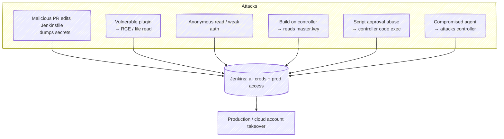
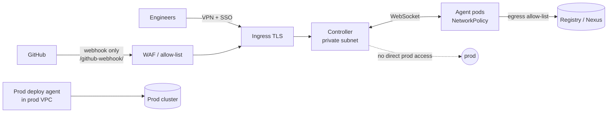

# 10 · Jenkins Security (hardening)

> **Goal:** secure the controller, users, agents, plugins and pipelines. Jenkins is a top attack target: it holds every secret and can deploy to prod.

[← Credentials](09-credentials-secrets.md) · [Next: JCasC & Job DSL →](11-jcasc-job-dsl.md)

---

## 1. Threat model (why it matters)

Real incidents: CVE-2024-23897 (CLI arbitrary file read → RCE), many plugin XSS/CSRF/credential-exposure advisories. Read the **Jenkins Security Advisories** page; patch fast.

---

## 2. Authentication (who are you) — Security Realm

| Realm | Use |
|-------|-----|
| Jenkins' own user DB | Lab only |
| **LDAP / Active Directory** | Enterprise directory |
| **OIDC** (`oic-auth` plugin) — Keycloak, Okta, Entra ID, Google | ⭐ SSO + MFA |
| **SAML** | Enterprise SSO |
| **GitHub OAuth** | GitHub-centric orgs |

Rules: SSO + MFA, no shared accounts, disable signup, API tokens per user (not passwords) for scripts, revoke legacy tokens.

## 3. Authorization (what can you do)

| Strategy | Notes |
|----------|-------|
| Anyone can do anything | ❌ Never |
| Logged-in users can do anything | ❌ Lab only |
| **Matrix-based security** | Global permission grid per user/group |
| **Project-based Matrix** | Matrix + per job/folder overrides ⭐ with folders |
| **Role-based Strategy** plugin | Global roles + item roles (regex on job names) + agent roles ⭐ |

Key permissions: `Overall/Administer` (god), `Overall/Read`, `Job/Build`, `Job/Configure` (= can change pipeline = can use job's credentials), `Job/Read`, `Credentials/View`, `Agent/Connect`, `Run/Replay` (= arbitrary code), `SCM/Tag`.

**Groups from SSO, not individual users.** Example roles: `admin` (platform team), `team-x-dev` (build/read on `team-x/.*`), `viewer`, `release-manager`.

---

## 4. Controller hardening checklist

- [ ] LTS version, patched within days of advisories.
- [ ] **Built-in node: 0 executors.**
- [ ] HTTPS only (TLS at ingress/LB), HSTS.
- [ ] Not exposed to internet; if needed → VPN / SSO proxy / allow-list; expose **only** webhook path.
- [ ] **CSRF protection** on (default; crumb issuer).
- [ ] **Agent → controller security** on (default since 2.326; can't be disabled now).
- [ ] Inbound TCP port 50000 disabled or firewalled → use WebSocket.
- [ ] CLI: disable remoting CLI (removed in modern versions); restrict HTTP CLI / disable if unused.
- [ ] **Markup formatter** = Safe HTML / plain text (prevents stored XSS in descriptions).
- [ ] Content Security Policy on archived artifacts (default strict — don't loosen globally).
- [ ] Script Console restricted to a tiny admin group; audit approvals.
- [ ] Run as non-root user; read-only root FS where possible (container).
- [ ] `Audit Trail` plugin → log who changed what; ship logs to SIEM.
- [ ] Back up `secrets/` separately and encrypted.
- [ ] JCasC so config drift is visible in Git.

## 5. Plugin security

- Each plugin = attack surface. **Minimum plugins.** Remove unused.
- Watch **Manage Jenkins → warnings** (security warnings banner).
- Pin versions in `plugins.txt`; update weekly in staging first.
- Avoid abandoned plugins ("up for adoption", no release in years).
- Plugin Installation Manager (`jenkins-plugin-cli`) resolves dependencies reproducibly.

## 6. Pipeline security

| Risk | Control |
|------|---------|
| Fork PR modifies Jenkinsfile to exfiltrate secrets | Multibranch fork trust = *Admin or Write*; PRs from forks get no credentials |
| Anyone with `Job/Configure`/`Replay` can run arbitrary code with job creds | Restrict those permissions; use Multibranch (config from SCM) |
| Secrets in logs | Single-quote `sh`, masking, no `set -x` |
| Script approval escalation | Don't approve dangerous signatures; trusted global lib for privileged ops |
| Shared global lib push access | Branch protection, CODEOWNERS, signed commits |
| Build containers break out | No privileged pods, no docker.sock, rootless builds, seccomp/PSA restricted |
| Supply chain (malicious deps / base images) | SCA (OWASP DC/Trivy), pinned digests, SBOM, image signing (cosign), provenance (SLSA) |
| Deploy creds overreach | Separate deploy agents/folders, short-lived OIDC creds, approvals for prod |

## 7. Network layout

## 8. Interview quick hits

- **How do you secure Jenkins?** SSO+MFA, RBAC via groups, 0 controller executors, ephemeral agents, folder-scoped creds / external secrets manager, minimal pinned plugins, patching, JCasC, audit logs, network isolation, fork PR restrictions.
- **Why is `Job/Configure` dangerous?** Configure = change pipeline code = use any credential that job can reach.
- **Where are credentials encrypted?** `credentials.xml` encrypted with `hudson.util.Secret` key, protected by `master.key`.
- **What's the crumb?** CSRF token; required for POSTs with session cookies (API tokens are exempt).
