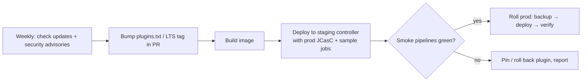

# 12 · Plugins (the ones that matter)

> **Goal:** know the essential plugins by name and job, and manage plugins without breaking Jenkins.

[← JCasC & Job DSL](11-jcasc-job-dsl.md) · [Next: SCM & Integrations →](13-scm-webhooks-integrations.md)

---

## 1. Essential plugin map

| Category | Plugin (id) | Why |
|----------|-------------|-----|
| Pipeline | `workflow-aggregator` | Pipeline suite (declarative, steps, CPS) |
| | `pipeline-graph-view` | Modern stage graph in classic UI |
| | `pipeline-utility-steps` | `readJSON`, `readYaml`, `zip`, `findFiles` |
| | `pipeline-stage-view` | Classic stage view |
| | `blueocean` | Old UI — not actively developed; avoid for new setups |
| SCM | `git`, `github-branch-source`, `gitlab-branch-source`, `cloudbees-bitbucket-branch-source` | Checkout + multibranch/org discovery |
| | `github` | Webhook trigger, commit status |
| | `generic-webhook-trigger` | Any webhook payload → variables |
| | `multibranch-scan-webhook-trigger` | Webhook triggers multibranch scan |
| Agents | `kubernetes` | Pod agents ⭐ |
| | `docker-workflow` | `agent { docker }`, `docker.build/push` |
| | `docker-plugin` | Docker cloud |
| | `ssh-slaves` | SSH Build Agents |
| | `ec2`, `azure-vm-agents` | Cloud VM agents |
| Config | `configuration-as-code` | JCasC ⭐ |
| | `job-dsl` | Job DSL ⭐ |
| Credentials | `credentials`, `credentials-binding`, `plain-credentials`, `ssh-credentials`, `ssh-agent` | Store + bind |
| | `hashicorp-vault-plugin` | Vault |
| | `kubernetes-credentials-provider` | K8s Secrets as creds |
| | `aws-secrets-manager-credentials-provider` | ASM as creds |
| Security | `matrix-auth` | Matrix authorization |
| | `role-strategy` | Role-based authorization ⭐ |
| | `oic-auth`, `saml`, `ldap`, `github-oauth` | SSO |
| | `audit-trail` | Who changed what |
| Quality | `junit` | Test reports |
| | `warnings-ng` | Lint/static analysis reports, quality gates |
| | `coverage` (replaces `jacoco`/`cobertura` UI) | Code coverage |
| | `sonar` | SonarQube scanner + `waitForQualityGate` |
| | `dependency-check-jenkins-plugin` | OWASP DC report |
| Build helpers | `timestamper`, `ansicolor`, `ws-cleanup`, `build-timeout`, `lockable-resources`, `throttle-concurrents`, `parameterized-trigger`, `rebuild`, `uno-choice` (Active Choices) | |
| Notifications | `slack`, `email-ext`, `office-365-connector` / MS Teams | Alerts |
| Ops | `prometheus`, `opentelemetry`, `metrics`, `monitoring` (JavaMelody), `thinBackup`, `disk-usage`, `build-discarder` | Observability, backup |
| Artifacts | `artifactory`, `nexus-artifact-uploader`, `copyartifact`, `s3` / `artifact-manager-s3` | Artifact handling |

---

## 2. Managing plugins

```text
# plugins.txt — pin versions (format id:version)
configuration-as-code:1850.va_a_8c31d3158b_
kubernetes:4295.v7fa_01b_309c95
workflow-aggregator:600.vb_57cdd26fdd7
git:5.5.2
```

```bash
jenkins-plugin-cli --plugin-file plugins.txt                     # install with deps
jenkins-plugin-cli --plugin-file plugins.txt --available-updates --output txt   # what's outdated
jenkins-plugin-cli --list                                        # installed
```

> Versions above are illustrative — regenerate with `--available-updates` against your LTS.

From a running Jenkins, export current plugins:

```groovy
// Script Console
Jenkins.instance.pluginManager.plugins.sort { it.shortName }.each { println "${it.shortName}:${it.version}" }
```

```bash
curl -s -u user:token "$JENKINS_URL/pluginManager/api/json?depth=1&tree=plugins[shortName,version]" \
  | jq -r '.plugins[] | "\(.shortName):\(.version)"' | sort
```

## 3. Upgrade strategy



Rules:
- Never click "update all" in prod UI.
- Upgrade **core + plugins together** (plugins declare minimum core).
- Read changelogs for breaking changes; check **Manage Jenkins → plugin warnings**.
- Keep previous image tag for instant rollback (plugins in image, not in volume, makes rollback trivial).
- Remove plugins nobody uses (fewer CVEs, faster boot).

## 4. Plugin troubleshooting

| Symptom | Fix |
|---------|-----|
| "Failed to load: X — dependency Y missing/too old" | Install/upgrade dependency; use `jenkins-plugin-cli` to resolve |
| Jenkins won't boot after plugin update | Restore previous image / remove `.jpi` from `plugins/` / disable via `touch plugins/x.jpi.disabled` |
| Old data warning ("Manage Old Data") | Plugin removed/changed format; discard after verifying |
| Plugin incompatible with core | Upgrade core or pin older plugin |
