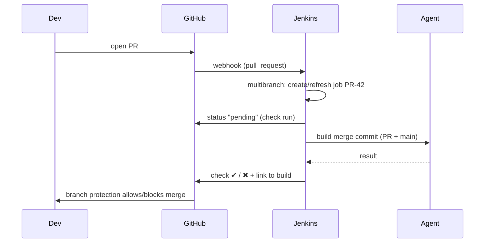

# 13 · SCM, Webhooks & Integrations

> **Goal:** wire GitHub/GitLab/Bitbucket into Jenkins properly — auth, webhooks, PR builds, status checks, monorepos, notifications.

[← Plugins](12-plugins.md) · [Next: Artifacts & Caching →](14-artifacts-caching.md)

---

## 1. Event flow



---

## 2. GitHub setup (⭐ GitHub App)

1. GitHub → Org settings → Developer settings → **GitHub Apps** → New.
   - Webhook URL: `https://jenkins.example.com/github-webhook/`, secret set.
   - Permissions: Contents **read**, Metadata read, Pull requests read, **Checks read/write**, Commit statuses read/write, Webhooks read. Events: push, pull_request, repository.
2. Generate private key → convert to PKCS#8:
   `openssl pkcs8 -topk8 -inform PEM -outform PEM -in key.pem -out key-pkcs8.pem -nocrypt`
3. Install app on org (all or selected repos).
4. Jenkins credential: **GitHub App** (App ID + key).
5. Multibranch / Org Folder source = GitHub, credential = the app.
6. Manage Jenkins → System → GitHub → add server, webhook shared secret.

Why App over PAT: not tied to a person, fine-grained, short-lived tokens, 5000+ req/h per installation, check runs API.

### Branch protection (GitHub side)
Require the Jenkins check (`continuous-integration/jenkins/pr-merge` or the Checks name) to pass + require up-to-date branch + code review.

## 3. GitLab
- Plugin `gitlab-branch-source` (multibranch) or `gitlab-plugin` (webhook + status).
- Webhook: `https://jenkins/project/<folder>/<job>` (gitlab-plugin) — secret token.
- Pipeline step: `gitlabCommitStatus(name: 'build') { ... }` / `updateGitlabCommitStatus name: 'build', state: 'success'`.

## 4. Bitbucket
- `cloudbees-bitbucket-branch-source` for Cloud/Server multibranch.
- Webhook: `https://jenkins/bitbucket-scmsource-hook/notify` (installed automatically if enabled).

## 5. Webhooks troubleshooting

| Problem | Check |
|---------|-------|
| No build on push | GitHub → webhook → *Recent Deliveries* (status code). Jenkins URL set? Trailing slash? |
| 403 from Jenkins | CSRF/crumb (use plugin endpoint, not `/build`), reverse proxy auth blocking path |
| 302 / login page | SSO proxy in front — exclude webhook path |
| Delivered 200 but no build | Job not matching repo URL/branch; multibranch needs scan; `Jenkinsfile` missing in branch |
| Jenkins private | Use a webhook relay (smee.io for labs, webhook proxy/relay service, or polling fallback) |

## 6. Checkout tuning

```groovy
checkout scmGit(
  branches: [[name: env.BRANCH_NAME]],
  extensions: [
    cloneOption(shallow: true, depth: 1, noTags: true, timeout: 10),
    sparseCheckout(sparseCheckoutPaths: [[path: 'services/payments'], [path: 'libs']]),
    cleanBeforeCheckout(),
    lfs()
  ],
  userRemoteConfigs: scm.userRemoteConfigs
)
```

- **Lightweight checkout** (job setting): fetch only `Jenkinsfile` on controller instead of full clone.
- **Reference repo / mirror** on agents for huge repos.
- Shallow clone breaks `git describe` / changelog → fetch tags if needed.

## 7. Monorepo patterns

```groovy
stage('payments') {
  when { changeset 'services/payments/**' }
  steps { sh 'make -C services/payments ci' }
}
```

- `changeset` compares with previous build of that branch (first build of a branch = everything changed) → for PRs compute diff vs target: `git diff --name-only origin/${CHANGE_TARGET}...HEAD`.
- Alternatives: one multibranch job per service with `scriptPath 'services/x/Jenkinsfile'` + path filters; or build tools with affected-graph (Bazel, Nx, Turborepo, Gradle).

## 8. Notifications & ChatOps

```groovy
slackSend channel: '#deploys', color: 'good', message: "Deployed ${APP}:${TAG} to prod by ${APPROVER}"
emailext to: '$DEFAULT_RECIPIENTS', recipientProviders: [culprits(), requestor()],
         subject: "${currentBuild.currentResult}: ${JOB_NAME} #${BUILD_NUMBER}",
         body: '${SCRIPT, template="groovy-html.template"}', attachLog: true
```

- Notify on **state change** (`fixed`, `regression`), not every success → avoid alert fatigue.
- Jira integration: link builds/deploys to issues via commit message keys.

## 9. Other integrations (one line each)

| Tool | Integration |
|------|-------------|
| Artifactory / Nexus | Push/pull artifacts, proxy remote repos (Maven/npm/PyPI/Docker) |
| SonarQube | `withSonarQubeEnv` + `waitForQualityGate` ([devsecops/sonarqube](../05-devsecops/sonarqube.md)) |
| Argo CD | Jenkins updates GitOps repo; Argo syncs ([16](16-docker-kubernetes-cicd.md)) |
| Terraform | `terraform plan` on PR, `apply` after approval (store plan as artifact) |
| Ansible | `ansiblePlaybook` step or `sh 'ansible-playbook ...'` |
| AWS | `withAWS(role: ..., region: ...)` (pipeline-aws plugin) or IRSA |
| PagerDuty / Opsgenie | Trigger on failed prod deploys |
