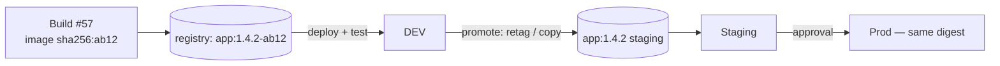

# 14 · Artifacts, Caching & Build Speed

> **Goal:** store outputs correctly, cache dependencies, and cut pipeline time.

[← SCM & Integrations](13-scm-webhooks-integrations.md) · [Next: Testing & Quality Gates →](15-testing-quality-gates.md)

---

## 1. Where artifacts go

| Artifact | Store | Not in |
|----------|-------|--------|
| Jar/war/npm/wheel | **Nexus / Artifactory / GitHub Packages / CodeArtifact** | Jenkins builds dir |
| Container image | **Registry** (ECR, GHCR, Harbor, ACR, GAR) | |
| Helm chart | OCI registry / ChartMuseum | |
| Test/scan reports | Jenkins (`junit`, `recordIssues`, `archiveArtifacts` small HTML/JSON) | |
| Large binaries/logs | S3/GCS (`artifact-manager-s3` makes `archiveArtifacts` go to S3) | `JENKINS_HOME` |
| Terraform plan | Archived artifact / S3 (encrypted) | |

`archiveArtifacts` on controller disk = disk fills, backups balloon. Keep it for small reports; push real artifacts to a repository manager.

```groovy
archiveArtifacts artifacts: 'build/libs/*.jar, reports/**', fingerprint: true, allowEmptyArchive: false
copyArtifacts projectName: 'app-build', selector: lastSuccessful(), filter: 'build/libs/*.jar'   // copyartifact plugin
```

## 2. Promotion model



Promote by **retagging the same digest** or copying between repos (`crane copy`, `skopeo copy`), never rebuilding.

## 3. Caching strategies

| Cache | Technique |
|-------|-----------|
| Maven/Gradle/npm/pip deps | **Repository manager proxy** (Nexus) ⭐ + local cache volume (PVC/hostPath/static agent dir) |
| Gradle build outputs | Gradle **remote build cache** |
| Docker layers | BuildKit `--cache-from/--cache-to type=registry`; order Dockerfile for cache hits |
| Git clone | Shallow clone, reference repos, mirrors |
| Node modules | `npm ci` with `~/.npm` cache dir mounted |
| Bazel/Nx/Turbo | Remote cache |
| Tool images | Pre-built CI images with tools baked in (`ci-java21:2026.10`) |

```bash
docker buildx build \
  --cache-from type=registry,ref=$REG/app:buildcache \
  --cache-to   type=registry,ref=$REG/app:buildcache,mode=max \
  -t $REG/app:$TAG --push .
```

## 4. Make pipelines fast — checklist

1. **Measure** first: stage durations (Pipeline Graph View, Prometheus metrics).
2. **Parallelize** independent stages (unit/lint/SAST).
3. Fail fast: cheap checks first, `failFast true`.
4. Cache deps (proxy + volume). Don't download the internet every build.
5. Pre-baked agent images; avoid `apt install` in pipeline.
6. Shallow clone, lightweight checkout of Jenkinsfile.
7. Only build what changed (monorepo `changeset`, affected graph).
8. Split slow E2E into nightly / post-merge; keep PR feedback < 10 min.
9. Test sharding across parallel agents (split by timing).
10. Right-size agent CPU/memory; avoid noisy-neighbor static agents.
11. `durabilityHint('PERFORMANCE_OPTIMIZED')` for high-volume pipelines.
12. Keep heavy Groovy out of the controller.

## 5. stash vs archive vs artifact repo

| | `stash` | `archiveArtifacts` | Repo manager |
|--|---------|--------------------|--------------|
| Purpose | Pass files between stages/agents in **one build** | Keep files with the build record | Distribute/version artifacts |
| Stored | Controller (temp, deleted after build unless preserved) | Controller `builds/` (or S3) | External |
| Size | Small | Small–medium | Any |
