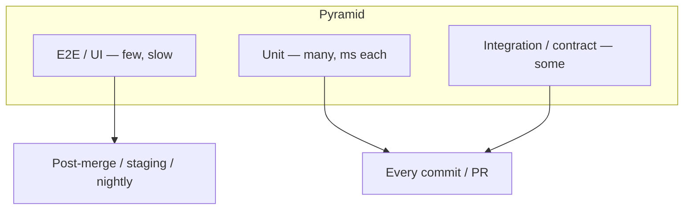

# 15 · Testing & Quality Gates

> **Goal:** know the test pyramid, which tests run where, and how to make the pipeline enforce quality.

[← Artifacts & Caching](14-artifacts-caching.md) · [Next: Docker & K8s CI/CD →](16-docker-kubernetes-cicd.md)

---

## 1. Test pyramid → pipeline stages



| Test | What | When in pipeline |
|------|------|------------------|
| Lint / format | Style, simple bugs | First, seconds |
| Unit | Function/class in isolation | Every PR |
| SAST / SCA / secrets | Code + deps + leaked secrets | Every PR |
| Integration | Service + real DB/queue (Testcontainers) | Every PR (if fast) |
| Contract (Pact) | Consumer/provider API agreements | PR |
| Container scan | Image CVEs/misconfig | After image build |
| E2E / UI | Full system flow | After deploy to staging |
| DAST | Attack running app (ZAP) | Staging |
| Performance / load (k6, JMeter, Gatling) | Latency/throughput SLOs | Staging / nightly |
| Smoke | Is it alive after deploy? | Every env, right after deploy |
| Chaos | Resilience | Scheduled, mature teams |

## 2. Publishing results

```groovy
junit testResults: '**/surefire-reports/*.xml', allowEmptyResults: false   // failures → UNSTABLE
recordCoverage tools: [[parser: 'JACOCO', pattern: '**/jacoco.xml']],
               qualityGates: [[threshold: 80.0, metric: 'LINE', baseline: 'PROJECT', criticality: 'FAILURE']]
recordIssues tools: [checkStyle(pattern: '**/checkstyle-result.xml'), spotBugs(), eslint(pattern: 'eslint.xml')],
             qualityGates: [[threshold: 1, type: 'NEW', unstable: false]]                // warnings-ng
```

JUnit XML is the universal format — make every test tool emit it (`pytest --junitxml`, `jest-junit`, `go-junit-report`).

## 3. Quality gate types

| Gate | Fail when |
|------|-----------|
| Tests | Any failure (or > N flaky) |
| Coverage | New code coverage < 80% |
| SonarQube Quality Gate | New bugs/vulns/hotspots, coverage, duplication |
| SCA | CVSS ≥ 7 / CRITICAL with fix available |
| Image scan | CRITICAL/HIGH fixable CVEs |
| IaC scan | Misconfig (public S3, privileged pod) |
| Secrets scan | Any secret found |
| Performance | p95 latency > SLO |
| Approval | Human sign-off (prod, change ticket) |

Gate on **new code** ("clean as you code") so legacy debt doesn't block every PR.

## 4. Flaky tests

- Detect: same commit, different results. Track with test-history (junit trends), Develocity/Launchable-style tools.
- Handle: quarantine tag + ticket, `retry` only around known infra flakiness — not around assertions.
- Root causes: time/ordering dependence, shared state, async waits with sleeps, network calls.

## 5. Ephemeral test environments

- **Testcontainers** in integration tests (needs Docker access from agent → use a Docker sidecar / Testcontainers Cloud).
- **Preview environments** per PR: deploy to namespace `pr-42` with Helm, run E2E, tear down in `post { cleanup }`.
- Compose-based: `docker compose up -d` → tests → `docker compose down -v`.
