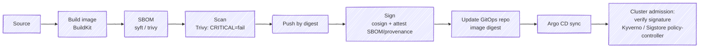
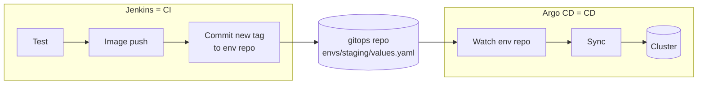

# 16 · Docker & Kubernetes in CI/CD (+ GitOps)

> **Goal:** build images safely from Jenkins, push them, deploy to Kubernetes (push vs GitOps), and sign what you ship.

[← Testing & Quality Gates](15-testing-quality-gates.md) · [Next: Deployment Strategies →](17-deployment-strategies.md)

---

## 1. Building images inside CI — options

| Method | Needs | Security | Notes |
|--------|-------|----------|-------|
| `docker build` via host socket | `/var/run/docker.sock` mount | ❌ root on node | Easy, dangerous |
| Docker-in-Docker (`docker:dind`) | Privileged sidecar | ⚠️ privileged | Isolated daemon per build |
| **BuildKit (rootless `buildkitd`)** | `moby/buildkit:rootless` sidecar or remote buildkitd | ✅ | ⭐ Fast, cache export, multi-arch |
| **Buildah** | Rootless with some settings | ✅ | Red Hat ecosystem, Dockerfile compatible |
| **Kaniko** | Runs as container, no daemon | ✅ | Popular; Google archived the original repo in 2025 — use a maintained fork (e.g. Chainguard's) or BuildKit |
| Jib / ko / Cloud Native Buildpacks | No Dockerfile; language-aware | ✅ | Java (Jib), Go (ko), buildpacks (`pack`) |
| Remote build service | AWS CodeBuild, Cloud Build, Depot | ✅ | Offload |

### BuildKit rootless in a K8s agent pod

```yaml
- name: buildkit
  image: moby/buildkit:rootless          # pin a version/digest in real use
  args: ["--oci-worker-no-process-sandbox"]
  securityContext:
    seccompProfile: { type: Unconfined }
    appArmorProfile: { type: Unconfined }
    runAsUser: 1000
    runAsGroup: 1000
```

```bash
buildctl-daemonless.sh build \
  --frontend dockerfile.v0 --local context=. --local dockerfile=. \
  --output type=image,name=$REG/app:$TAG,push=true \
  --export-cache type=registry,ref=$REG/app:cache --import-cache type=registry,ref=$REG/app:cache
```

### Docker Pipeline plugin (on a Docker-enabled agent)

```groovy
def img = docker.build("${REG}/app:${TAG}", '--pull .')
docker.withRegistry("https://${REG}", 'ecr:eu-west-1:aws-creds') {    // amazon-ecr plugin syntax
  img.push()
  img.push('latest-main')
}
```

## 2. Image pipeline (secure supply chain)



```bash
syft $REG/app:$TAG -o spdx-json > sbom.json
trivy image --exit-code 1 --severity CRITICAL --ignore-unfixed $REG/app:$TAG
DIGEST=$(crane digest $REG/app:$TAG)
cosign sign --yes $REG/app@$DIGEST                               # keyless (OIDC) or --key
cosign attest --yes --predicate sbom.json --type spdxjson $REG/app@$DIGEST
```

## 3. Deploying to Kubernetes — push vs pull

| | **Push (CI deploys)** | **Pull (GitOps)** ⭐ |
|--|-----------------------|----------------------|
| Who touches cluster | Jenkins runs `kubectl/helm` | Argo CD / Flux inside cluster |
| Cluster creds in CI | Yes (risk) | No |
| Source of truth | Pipeline run | Git repo |
| Drift detection | No | Yes, auto-heal |
| Rollback | Re-run old pipeline / `helm rollback` | `git revert` |
| Audit | Jenkins logs | Git history |



### Push deploy (simple)

```groovy
withCredentials([file(credentialsId: 'kubeconfig-staging', variable: 'KUBECONFIG')]) {
  sh '''
    helm upgrade --install api charts/api -n staging \
      --set image.tag=${TAG} --atomic --wait --timeout 5m
    kubectl -n staging rollout status deploy/api --timeout=180s
  '''
}
```

`--atomic` = auto-rollback if upgrade fails. `--wait` = wait for ready.

### GitOps promote (Jenkins updates repo, Argo deploys)

```groovy
withCredentials([sshUserPrivateKey(credentialsId: 'gitops-deploy-key', keyFileVariable: 'KEY')]) {
  sh '''
    export GIT_SSH_COMMAND="ssh -i $KEY -o StrictHostKeyChecking=accept-new"
    git clone git@github.com:acme/gitops.git && cd gitops
    yq -i ".image.tag = \\"${TAG}\\"" envs/staging/api/values.yaml
    git commit -am "api: ${TAG} → staging (build ${BUILD_URL})"
    git push origin main
  '''
}
```

Prod: Jenkins opens a **PR** to the prod env folder → humans approve → Argo syncs. Or Argo CD Image Updater / Kargo for automated promotion.

## 4. Helm in pipelines

```bash
helm lint charts/api
helm template charts/api -f values-staging.yaml | kubeconform -strict -summary   # schema validate
helm package charts/api --version $CHART_VER --app-version $TAG
helm push api-$CHART_VER.tgz oci://$REG/charts
helm diff upgrade api charts/api -f values-prod.yaml                             # helm-diff plugin, on PR
```

## 5. Agent RBAC for push deploys

```yaml
apiVersion: rbac.authorization.k8s.io/v1
kind: Role
metadata: { name: deployer, namespace: staging }
rules:
- apiGroups: ["apps"]
  resources: ["deployments", "replicasets"]
  verbs: ["get", "list", "watch", "create", "update", "patch"]
- apiGroups: [""]
  resources: ["services", "configmaps", "pods", "secrets"]
  verbs: ["get", "list", "watch", "create", "update", "patch"]
```

Bind to a namespace-scoped ServiceAccount, never `cluster-admin`.
