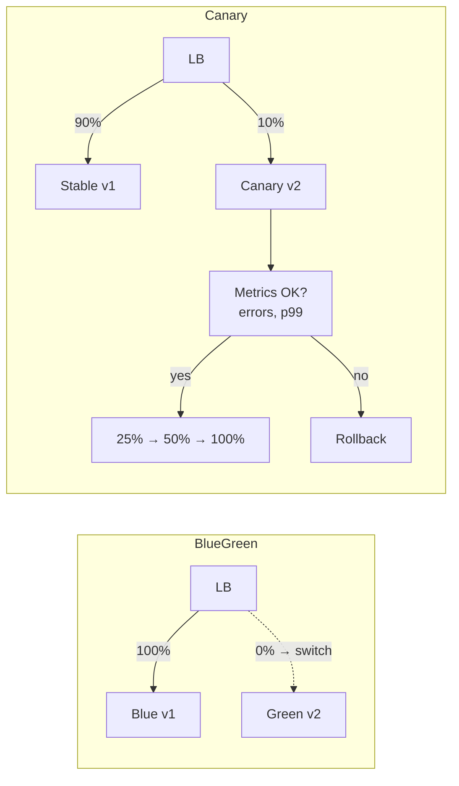

# 17 · Deployment Strategies & Release Engineering

> **Goal:** name every deploy strategy, when to use it, how to roll back, and how Jenkins drives it.

[← Docker & K8s CI/CD](16-docker-kubernetes-cicd.md) · [Next: Scaling & HA →](18-scaling-ha-performance.md)

---

## 1. Strategies

| Strategy | How | Downtime | Rollback | Cost | Use |
|----------|-----|----------|----------|------|-----|
| **Recreate** | Stop old, start new | Yes | Redeploy old | 1× | Dev, singletons, DB-incompatible changes |
| **Rolling** | Replace pods gradually (`maxSurge`/`maxUnavailable`) | No | `rollout undo` | ~1× | ⭐ K8s default |
| **Blue/Green** | Two full envs; switch traffic at LB/Service | No | Switch back (instant) | 2× | Critical apps, fast rollback |
| **Canary** | Small % traffic to new, grow on good metrics | No | Shift to 0% | ~1.1× | ⭐ High-traffic prod |
| **A/B testing** | Route by user attribute to compare features | No | | | Product experiments |
| **Shadow / dark launch** | Mirror traffic to new, discard responses | No | n/a | 2× | Risky rewrites |
| **Feature flags** | Deploy code dark, toggle per user/% | No | Flip flag | 1× | ⭐ Decouple deploy from release |
| **Ring / wave** | Internal → 1% → region → global | No | Stop wave | | Large orgs |



## 2. Progressive delivery tools

| Tool | What |
|------|------|
| **Argo Rollouts** | K8s CRD replacing Deployment; canary/blue-green steps + automated analysis (Prometheus queries) |
| **Flagger** | Canary automation with service mesh / ingress |
| Service mesh (Istio, Linkerd) | Weighted traffic split |
| LaunchDarkly / Unleash / Flagsmith / OpenFeature | Feature flags |

Argo Rollouts canary sketch:

```yaml
strategy:
  canary:
    steps:
      - setWeight: 10
      - pause: { duration: 5m }
      - analysis: { templates: [{ templateName: error-rate }] }
      - setWeight: 50
      - pause: { duration: 10m }
```

## 3. Jenkins-driven canary (without Rollouts)

```groovy
stage('Canary 10%') { steps { sh './deploy.sh canary 10' } }
stage('Analyze') {
  steps {
    script {
      def err = sh(returnStdout: true, script: '''
        curl -s "$PROM/api/v1/query" --data-urlencode \
          'query=sum(rate(http_requests_total{app="api",track="canary",code=~"5.."}[5m])) / sum(rate(http_requests_total{app="api",track="canary"}[5m]))' \
          | jq -r '.data.result[0].value[1] // "0"'
      ''').trim() as BigDecimal
      if (err > 0.01) { error "Canary error rate ${err} > 1%" }
    }
  }
}
stage('Promote 100%') { steps { sh './deploy.sh stable 100' } }
post { failure { sh './deploy.sh rollback' } }
```

## 4. Rollback

| Level | How |
|-------|-----|
| K8s | `kubectl rollout undo deploy/api` / `helm rollback api <rev>` |
| GitOps | `git revert <commit>` in env repo |
| Blue/green | Point Service/LB back to blue |
| Feature flag | Turn off |
| DB | **Expand/contract** migrations so old code works with new schema; rarely roll back schema |

**Roll forward vs roll back:** roll back if fast & safe; roll forward if fix is small and rollback is risky (e.g. migrations ran).

## 5. Database migrations in CD

Expand → migrate → contract:
1. **Expand**: add new column/table (backward compatible). Deploy.
2. App writes both / backfill.
3. Switch reads to new.
4. **Contract**: drop old column in a later release.

Tools: Flyway, Liquibase, Alembic, golang-migrate. Run as a pipeline stage or K8s Job / Helm hook before app rollout.

## 6. Release engineering terms

| Term | Means |
|------|-------|
| Release train | Fixed schedule releases |
| Change freeze | No deploys window (holidays) |
| Change Advisory Board (CAB) | Approval body; automated evidence replaces it in modern CD |
| Deployment window | Allowed hours |
| Hotfix | Urgent patch path, still through pipeline |
| Semantic release | Auto version + changelog from Conventional Commits |
| Release notes | Generated from commits/PR labels |
| Environment promotion | dev → staging → prod with same artifact |
