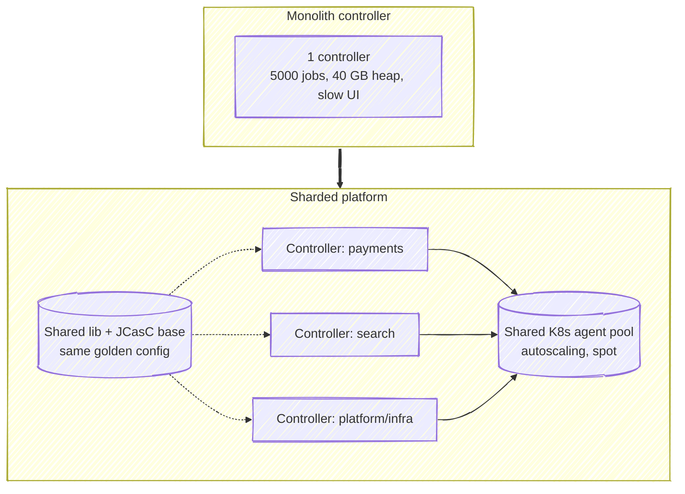

# 18 · Scaling, HA & Performance

> **Goal:** scale Jenkins from 10 to 10,000 builds/day and answer "how do you make Jenkins highly available?"

[← Deployment Strategies](17-deployment-strategies.md) · [Next: Backup, DR & Upgrades →](19-backup-dr-upgrades.md)

---

## 1. The scaling truth

- One controller = one JVM = **no horizontal scaling** (OSS).
- Scale **agents** horizontally (K8s/cloud, elastic).
- Scale **controllers** by splitting: per team / BU / domain ("controller sharding").
- HA in OSS = **fast recovery** (stateless-ish controller via JCasC + persistent volume + auto-restart), not active/active.

## 2. HA options

| Option | RTO | Notes |
|--------|-----|-------|
| K8s StatefulSet + PV + liveness probe | Minutes (pod reschedule + boot) | ⭐ Most common. Single-AZ EBS → use zonal awareness or EFS/regional disks |
| Active/passive VMs + shared storage (NFS/EFS) | Minutes | Only one active at a time (two controllers on same `JENKINS_HOME` = corruption) |
| Rebuild from code (JCasC + image + seed) | ~10–20 min | History lost unless volume restored; jobs/config recovered |
| CloudBees CI HA (active/active) | Seconds | Commercial |

Running builds **resume** after controller restart (durable pipeline) if agents survive/reconnect; K8s agent pods may get orphaned — design pipelines to be **idempotent** & re-runnable.

## 3. Controller performance tuning

| Area | Action |
|------|--------|
| Heap | `-XX:MaxRAMPercentage=70`, watch GC logs; don't exceed ~16–24 GB (split instead) |
| GC | G1GC default; enable GC logging `-Xlog:gc*:file=/var/jenkins_home/gc.log:time` |
| Disk | SSD / provisioned IOPS for `JENKINS_HOME`; IO is often the bottleneck |
| Build retention | `buildDiscarder` everywhere; delete old builds/artifacts |
| Plugins | Fewer plugins = faster boot, less memory |
| Executors on controller | 0 |
| Pipeline | `PERFORMANCE_OPTIMIZED` durability, less Groovy, fewer `echo`s in tight loops |
| Polling | Replace `pollSCM` with webhooks |
| Multibranch scans | Webhook-driven; long periodic interval |
| Logs | Huge console logs slow UI → limit verbosity, ship logs elsewhere |
| Artifacts | Off controller (S3 artifact manager) |
| Thread dumps | `/threadDump` when UI hangs |

## 4. Agent scaling

- Kubernetes plugin `containerCap`, pod templates per workload size (`small`, `large`, `gpu`).
- **Cluster autoscaler / Karpenter** scales nodes; spot instances for agents (builds are retryable).
- Warm pool / `idleMinutes` to cut cold start for busy labels.
- Queue length metric → alert when builds wait > N minutes (`jenkins_queue_size_value`).
- Avoid **label starvation**: too-specific labels leave executors idle while queue grows.

## 5. Capacity metrics to watch

| Metric | Healthy |
|--------|---------|
| Queue length / time in queue | Near 0 / < 1 min |
| Executor utilization | 60–80% peak |
| Controller heap after GC | < 70% |
| Build duration p50/p95 | Stable or dropping |
| Agent provision time | < 60 s (pods) |
| Disk free `JENKINS_HOME` | > 20% |
| HTTP response time UI | < 1 s |

## 6. Interview answer: "Jenkins is slow, what do you do?"

1. Identify *what* is slow: UI, queue wait, or build itself.
2. **UI slow** → heap/GC (`jstat`, GC log), thread dump, too many jobs/builds, plugin hotspot → retention, upgrade, split controller.
3. **Queue wait** → not enough agents / label mismatch / cloud cap / quota → autoscaling, fix labels.
4. **Build slow** → stage timings → caching, parallelism, shallow clone, bigger agents, skip unchanged.
5. Add monitoring (Prometheus plugin + Grafana) so next time you see it first.
