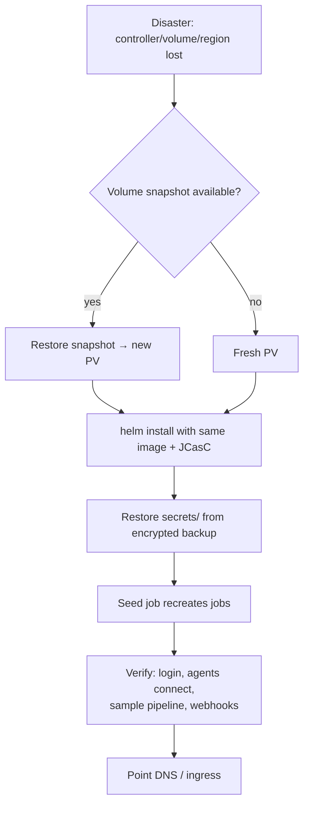

# 19 · Backup, Disaster Recovery & Upgrades

> **Goal:** never lose Jenkins, recover in minutes, upgrade without drama.

[← Scaling & HA](18-scaling-ha-performance.md) · [Next: Monitoring Jenkins →](20-monitoring-jenkins.md)

---

## 1. What to back up

| Item | Path | Needed? |
|------|------|---------|
| Global config | `$JENKINS_HOME/*.xml` | ✅ (or JCasC in Git) |
| Job configs | `jobs/**/config.xml` | ✅ (or Job DSL in Git) |
| Build history | `jobs/**/builds/` | Optional (compliance/audit) |
| Secrets | `secrets/` (`master.key`, `hudson.util.Secret`) | ✅ **critical**, store encrypted separately |
| Credentials | `credentials.xml` + folder configs | ✅ (useless without `secrets/`) |
| Users | `users/` | ✅ unless SSO-only |
| Plugins | `plugins/*.jpi` | ❌ if pinned in `plugins.txt`/image |
| Nodes | `nodes/` | ✅ (or JCasC) |
| Workspaces | `workspace/` | ❌ never |
| Caches, logs, `war/`, `.cache` | | ❌ |

## 2. Backup methods

| Method | Notes |
|--------|-------|
| **Volume snapshots** (EBS/PD/Velero) | ⭐ Fast, consistent-ish; schedule hourly/daily |
| `thinBackup` plugin | Scheduled, diff backups to a dir; restore from UI |
| `tar` + cron + upload to S3 | Simple; exclude workspace/caches |
| Git (JCasC + Job DSL + Jenkinsfiles) | ⭐ Config recovery without backups |

```bash
# consistent-enough backup: quiet down first for big instances
curl -X POST -u admin:$TOKEN "$JENKINS_URL/quietDown"
tar --exclude='workspace' --exclude='caches' --exclude='*.log' --exclude='war' \
    -czf jenkins-$(date +%F).tgz -C /var/jenkins_home .
aws s3 cp jenkins-$(date +%F).tgz s3://acme-jenkins-backup/ --sse aws:kms
curl -X POST -u admin:$TOKEN "$JENKINS_URL/cancelQuietDown"
```

## 3. DR plan



| Target | Typical |
|--------|---------|
| **RPO** (data loss tolerated) | 1–24 h (snapshot frequency) |
| **RTO** (time to recover) | 15–60 min |

**Test restores quarterly.** An untested backup is a hope.

## 4. Upgrades

### LTS upgrade runbook
1. Read LTS **upgrade guide** + changelog (Java version changes, removed features).
2. Bump image tag + `plugins.txt` in PR.
3. Deploy to **staging controller** with prod JCasC; run smoke pipelines (one per golden path).
4. Prod: announce → `quietDown` (wait for running builds) → snapshot volume → deploy new image → watch logs (`SEVERE`) → run smoke jobs → `cancelQuietDown` automatically on restart.
5. Rollback: previous image tag + restore snapshot if data format migrated.

```bash
curl -X POST -u admin:$TOKEN $JENKINS_URL/safeRestart      # restart when builds finish
curl -X POST -u admin:$TOKEN $JENKINS_URL/quietDown        # stop scheduling new builds
curl -X POST -u admin:$TOKEN $JENKINS_URL/reload           # reload config from disk
```

### Java upgrades
Jenkins moved Java 8 → 11 → 17 → 21 baseline over time. Controller **and agents** must run a supported Java; check before upgrading LTS.

## 5. Migration (VM → K8s)
1. Freeze config changes. 2. Export plugins list + JCasC export. 3. Rsync `JENKINS_HOME` (minus workspace) to PV. 4. Same Jenkins version first, then upgrade. 5. Repoint agents/webhooks/DNS. 6. Run old & new in parallel read-only for a week if possible.
