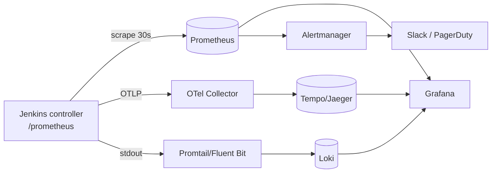

# 20 · Monitoring & Observability of Jenkins

> **Goal:** see controller health, queue, agents and pipeline performance in Grafana; alert before users complain.

[← Backup, DR & Upgrades](19-backup-dr-upgrades.md) · [Next: Troubleshooting →](21-troubleshooting.md)

Prometheus/Grafana basics live in [observability/](../06-observability/prometheus.md). This page = Jenkins-specific.

---

## 1. Signals

| Signal | Source |
|--------|--------|
| Metrics | `prometheus` plugin → `/prometheus` endpoint |
| Traces | `opentelemetry` plugin → each build = trace, each stage/step = span (Jaeger/Tempo) |
| Logs | Controller logs (stdout / `jenkins.log`), build console logs → Loki/ELK |
| Health | `/login` or `/whoAmI` HTTP check; `/metrics/<key>/healthcheck` (metrics plugin) |
| Audit | `audit-trail` plugin |
| JVM | JMX / Prometheus JVM metrics, GC logs |



## 2. Prometheus scrape

```yaml
scrape_configs:
  - job_name: jenkins
    metrics_path: /prometheus/
    scheme: https
    static_configs:
      - targets: ['jenkins.example.com']
    # if authentication required for metrics:
    # basic_auth: { username: prometheus, password_file: /etc/prom/jenkins-token }
```

K8s: annotate service or use a `ServiceMonitor` (kube-prometheus-stack). Helm chart: `controller.prometheus.enabled: true`.

## 3. Key metrics (Prometheus plugin)

Verified against prometheus plugin on Jenkins LTS (2026). Names can shift between plugin versions — check `/prometheus/`. Per-job metrics appear after the collection period (default 120 s).

| Metric | Meaning |
|--------|---------|
| `jenkins_queue_size_value` | Builds waiting |
| `jenkins_queue_buildable_value` / `jenkins_queue_stuck_value` | Waiting for executor / stuck |
| `jenkins_executor_count_value`, `jenkins_executor_in_use_value`, `jenkins_executor_free_value` | Capacity |
| `jenkins_node_online_value`, `jenkins_node_offline_value` | Agents |
| `jenkins_health_check_score` | 0–1 overall health |
| `jenkins_job_count_value` | Jobs |
| `default_jenkins_builds_last_build_duration_milliseconds{jenkins_job=...}` | Last build duration per job |
| `default_jenkins_builds_duration_milliseconds_summary_sum` / `_count` | Avg duration = sum / count (no quantiles by default) |
| `default_jenkins_builds_last_build_result_ordinal` | 0 success, 1 unstable, 2 failure, 3 not built, 4 aborted |
| `default_jenkins_builds_total_build_count_total` / `..._success_build_count_total` / `..._failed_build_count_total` | Counters → success rate |
| `default_jenkins_builds_last_stage_duration_milliseconds_summary_*` | Per-stage timing |
| `default_jenkins_executors_busy` / `_available` / `_queue_length` | Executor view per label set |
| `jenkins_job_queuing_duration` / `jenkins_job_building_duration` | Time in queue vs building |
| `jvm_memory_bytes_used{area="heap"}`, `jvm_gc_collection_seconds_*` | JVM |

## 4. Alerts (start with these)

```yaml
groups:
- name: jenkins
  rules:
  - alert: JenkinsDown
    expr: up{job="jenkins"} == 0
    for: 2m
    labels: { severity: critical }
  - alert: JenkinsQueueBacklog
    expr: jenkins_queue_size_value > 10
    for: 15m
    labels: { severity: warning }
    annotations: { summary: "{{ $value }} builds queued 15m — agents short?" }
  - alert: JenkinsAgentsOffline
    expr: jenkins_node_offline_value > 0
    for: 10m
  - alert: JenkinsHeapHigh
    expr: jvm_memory_bytes_used{job="jenkins",area="heap"} / jvm_memory_bytes_max{job="jenkins",area="heap"} > 0.85
    for: 10m
  - alert: JenkinsHealthLow
    expr: jenkins_health_check_score < 1
    for: 10m
```

Full rules: [templates/monitoring/jenkins-alerts.yml](../03-templates/monitoring/jenkins-alerts.yml).

## 5. Grafana dashboard panels

1. Up/health score · 2. Queue size (time series) · 3. Executors used vs total · 4. Agents online/offline · 5. Build success rate (%) per job · 6. Last build duration per job · 7. Heap + GC time · 8. Top 10 slowest/most failing jobs.

Community dashboard: search grafana.com dashboards for "Jenkins Prometheus" (e.g. ID **9964** "Jenkins: Performance and Health Overview") as a starting point.

## 6. CI/CD (DORA) metrics from Jenkins

- Deployment frequency = count of successful prod deploy stage runs.
- Lead time = commit timestamp → prod deploy timestamp (record both as build metadata / push to a metrics DB).
- Success rate per job: `default_jenkins_builds_success_build_count_total / default_jenkins_builds_total_build_count_total`.
- Change failure rate = failed or rolled-back prod deploys / total.
- Tools: Apache DevLake, Four Keys-style pipelines, or emit custom metrics via Pushgateway / OpenTelemetry from the deploy stage.
