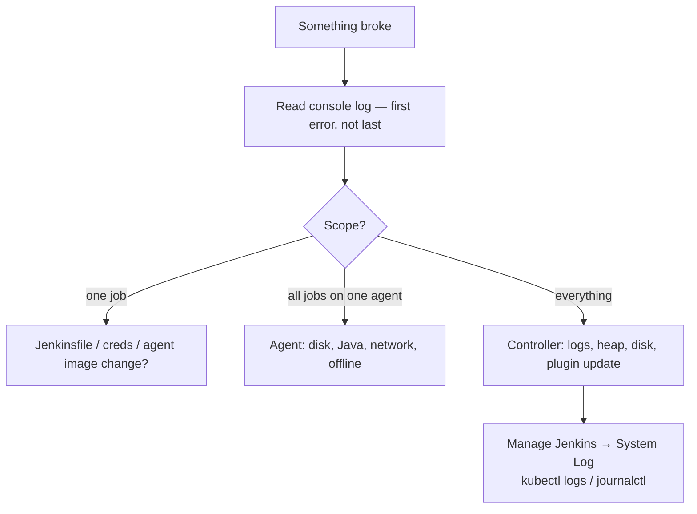

# 21 · Troubleshooting Playbook

> **Goal:** symptom → cause → fix. The errors you will actually see.

[← Monitoring Jenkins](20-monitoring-jenkins.md) · [Next: Jenkins vs Others →](22-jenkins-vs-others.md)

---

## 1. Investigation order



## 2. Common errors

| Symptom / error | Cause | Fix |
|-----------------|-------|-----|
| Build stuck "Waiting for next available executor on 'label'" | No agent with label / cloud cap / pod Pending | Check label spelling, node online, K8s events, quota |
| `There are no nodes with the label ‘x’` | Label typo or agent removed | Fix label expression |
| Agent offline / `Connection was broken` | Network, controller URL, port 50000 blocked, Java mismatch | WebSocket, check `jenkinsUrl`/tunnel, agent logs |
| K8s pod `ErrImagePull` / Pending | Image/registry auth, resources, node selectors | `kubectl describe pod`, `podRetention: onFailure` |
| `script returned exit code 1/127/137` | Command failed / not found / OOM-killed | 127: missing tool in image; 137: raise memory limit |
| `process apparently never started` | Durable-task wrapper can't write to workspace / slow FS | Check workspace perms, `HEARTBEAT_CHECK_INTERVAL`, `-u` mismatch in docker agent |
| `RejectedAccessException: Scripts not permitted to use method` | Sandbox | Approve if safe, or move logic to trusted lib / `sh` |
| `NotSerializableException` | Non-serializable object across CPS step | `@NonCPS` / don't keep Matcher/iterators in vars |
| `MissingPropertyException: No such property: X` | Typo, var scope, `env.X` unset | `def`, check param names, `env.getProperty` |
| `No such DSL method 'xyz'` | Plugin not installed / shared lib not loaded | Install plugin, `@Library`, check spelling |
| `Method code too large` | Jenkinsfile too big | Shared library / functions |
| `HTTP 403 No valid crumb was included` | CSRF | Use API token auth, or fetch crumb with same session |
| `Permission denied (publickey)` in git | Wrong SSH cred / known_hosts | Credential id, `Git Host Key Verification` config |
| `Couldn't find any revision to build` | Branch spec wrong | `*/main`, check refspec |
| Workspace `@2`, `@tmp` dirs | Concurrent builds / temp | Normal; clean old ones |
| Disk full on controller | Build history/artifacts | `buildDiscarder`, S3 artifacts, delete old builds |
| Jenkins won't start after upgrade | Plugin incompatibility | Logs `SEVERE`, revert image, disable plugin (`.jpi.disabled`) |
| UI super slow / `OutOfMemoryError` | Heap, too many builds, plugin leak | Heap dump/thread dump, retention, split controller |
| `docker: permission denied ... docker.sock` | Agent user not in docker group | Use rootless builder, or group access (risky) |
| Secrets show in log | Interpolated in Groovy / transformed | Single quotes, no `set -x` |
| Webhook not triggering | URL/secret/proxy/SSO | GitHub "Recent Deliveries"; see [13](13-scm-webhooks-integrations.md) |
| Parameters missing on first run | Defined in Jenkinsfile | Run once; defaults used |
| `java.lang.InterruptedException` / aborted | Timeout or newer build aborted it | Check `timeout`, `disableConcurrentBuilds(abortPrevious)` |

## 3. Debug tools

```bash
# Controller logs
kubectl -n jenkins logs sts/jenkins -c jenkins -f
journalctl -u jenkins -f

# Thread & heap
curl -u admin:$TOKEN $JENKINS_URL/threadDump > threads.txt
jcmd <pid> GC.heap_dump /tmp/heap.hprof
jcmd <pid> Thread.print

# Agent pods
kubectl -n jenkins-agents get pods -w
kubectl -n jenkins-agents describe pod <pod>
kubectl -n jenkins-agents logs <pod> -c jnlp
```

- **Manage Jenkins → System Log → Add new log recorder** (e.g. `org.csanchez.jenkins.plugins.kubernetes` at FINE) for plugin-level debug.
- **Replay** to try a pipeline fix without committing.
- `sh 'env | sort'`, `sh 'id; pwd; ls -la'` — first three debug lines inside any failing step.
- Script Console (admin): inspect queue, kill stuck builds:

```groovy
Jenkins.instance.queue.clear()                                              // clear queue
Jenkins.instance.getItemByFullName('team/app/main').getBuildByNumber(42).doStop()
Jenkins.instance.getItemByFullName('team/app/main').getBuildByNumber(42).doKill()  // hard kill zombie
```

## 4. Stuck build escalation
1. UI **Abort** → 2. `.../42/stop` → 3. `.../42/term` → 4. `.../42/kill` (URL endpoints appear after previous step fails).
