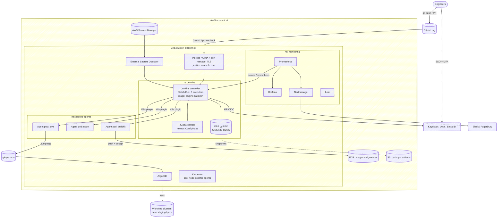

# 04 · Mega Setup: Production Jenkins Platform

> Step-by-step build of a production-grade Jenkins platform: Jenkins on Kubernetes, everything as code, ephemeral agents, SSO, external secrets, DevSecOps gates, GitOps CD, monitoring, backups. No app included. Plug any app in through the golden pipeline.

[← README](../README.md)

---

## 1. Target architecture



## 2. Design decisions (what makes it "the best")

| Decision | Why |
|----------|-----|
| Controller on K8s via Helm, plugins baked in a custom image | Reproducible. Rollback = previous image tag |
| **JCasC + Job DSL + shared library in Git** | Controller is cattle. Rebuild from scratch in 15 min |
| **0 executors on controller** | Builds can't read secrets / starve controller |
| **Ephemeral K8s pod agents on Karpenter spot nodes** | Clean env per build, scale to zero, ~70% cheaper |
| **Rootless BuildKit** | No privileged pods, no docker.sock |
| **OIDC SSO + role-based RBAC by IdP groups** | No local users, offboarding = remove from IdP |
| **External Secrets Operator → AWS Secrets Manager** | No secrets in Git or in UI; rotation in one place |
| **IRSA / Pod Identity for AWS access** | No static AWS keys at all |
| **GitHub App** auth | Not tied to a person, higher rate limits, checks API |
| **Golden pipeline (shared library)** | 5-line Jenkinsfile per repo; security gates enforced centrally |
| **DevSecOps gates**: gitleaks, Sonar, Trivy, SBOM, cosign | Shift-left + supply chain integrity |
| **GitOps CD with Argo CD** | Jenkins has zero prod cluster creds; Git = audit log |
| **Prometheus + Grafana + Alertmanager** | Know about queue/agent/heap problems before users do |
| **Snapshots + config-in-Git** | RPO 1h, RTO < 30 min, tested restores |
| **Staging controller for upgrades** | No surprise breakage from plugin updates |

## 3. Pipeline flow (every app)

```mermaid
flowchart LR
    PR[PR opened] --> CI1[Build + unit]
    CI1 --> SEC[gitleaks · Sonar · Trivy fs/config]
    SEC --> QG{Quality gate}
    QG -->|fail| X[❌ PR blocked]
    QG -->|pass| OK[✅ check green → merge]
    OK --> MAIN[main build]
    MAIN --> IMG[BuildKit image → ECR]
    IMG --> SCAN[Trivy image + SBOM]
    SCAN --> SIGN[cosign sign + attest]
    SIGN --> STG[GitOps: bump staging]
    STG --> ARGO1[Argo CD sync staging]
    ARGO1 --> E2E[Smoke / E2E / ZAP]
    E2E --> PRPR[PR to prod env folder]
    PRPR -->|approve| ARGO2[Argo CD sync prod<br/>Argo Rollouts canary]
```



## 4. Steps

| # | Step | Time |
|---|------|------|
| 01 | [Prerequisites & repo layout](steps/01-prerequisites.md) | 15 min |
| 02 | [Cluster add-ons: ingress, cert-manager, ESO, Karpenter pool](steps/02-cluster-addons.md) | 45 min |
| 03 | [Custom controller image](steps/03-controller-image.md) | 20 min |
| 04 | [Secrets: AWS SM → ESO → Jenkins](steps/04-secrets.md) | 20 min |
| 05 | [Install controller with Helm + JCasC](steps/05-install-helm-jcasc.md) | 30 min |
| 06 | [SSO + RBAC](steps/06-sso-rbac.md) | 30 min |
| 07 | [Kubernetes agents](steps/07-kubernetes-agents.md) | 30 min |
| 08 | [GitHub App, webhooks, seed job](steps/08-github-seed-jobs.md) | 30 min |
| 09 | [Shared library golden pipeline](steps/09-shared-library.md) | 30 min |
| 10 | [DevSecOps: SonarQube, Trivy, signing](steps/10-devsecops.md) | 45 min |
| 11 | [GitOps CD with Argo CD](steps/11-gitops-argocd.md) | 45 min |
| 12 | [Monitoring & alerting](steps/12-monitoring.md) | 30 min |
| 13 | [Backup, DR, upgrades](steps/13-backup-dr-upgrades.md) | 30 min |
| 14 | [Go-live checklist](steps/14-go-live-checklist.md) | 15 min |

Total: about one working day if the EKS cluster already exists. Add 1–2 hours to create the cluster.

## 5. Config files

| File | Purpose |
|------|---------|
| [config/helm-values.yaml](config/helm-values.yaml) | Helm values for the controller |
| [config/plugins.txt](config/plugins.txt) | Plugin list for the custom image |
| [config/Dockerfile](config/Dockerfile) | Controller image |
| [config/external-secrets.yaml](config/external-secrets.yaml) | SecretStore + ExternalSecret |
| [config/karpenter-ci-nodepool.yaml](config/karpenter-ci-nodepool.yaml) | Spot node pool for agents |
| [config/argocd-app.yaml](config/argocd-app.yaml) | Argo CD ApplicationSet per env |
| [config/servicemonitor.yaml](config/servicemonitor.yaml) | Prometheus scrape + alert rules |
| [config/velero-schedule.yaml](config/velero-schedule.yaml) | Backup schedule |
| [../03-templates/jcasc/jenkins.yaml](../03-templates/jcasc/jenkins.yaml) | Full JCasC (split into ConfigMaps by Helm) |
| [../03-templates/job-dsl/seed.groovy](../03-templates/job-dsl/seed.groovy) | Seed job DSL |
| [../03-templates/shared-library/](../03-templates/shared-library/) | Golden pipeline library |
| [../03-templates/k8s/](../03-templates/k8s/) | Agent namespace, PVCs, pod templates |

## 6. Repo layout you create (`acme/jenkins-config`)

```text
jenkins-config/
├── image/                 Dockerfile + plugins.txt   → CI builds controller image
├── helm/values.yaml       controller Helm values
├── casc/                  jenkins.yaml split per concern (security, clouds, creds, libs)
├── seed/                  seed.groovy + teams.yaml
├── k8s/                   agent namespace, PVCs, ExternalSecrets, ServiceMonitor
└── jobs/                  Jenkinsfiles for ops jobs (backup check, cleanup)
platform-lib/              shared library (separate repo, tagged releases)
gitops/                    env repo watched by Argo CD
```
