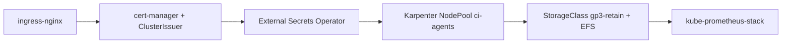

# Step 02 · Cluster Add-ons

[← Prerequisites](01-prerequisites.md) · [Next: Controller image →](03-controller-image.md)

---

Install once per CI cluster: ingress, TLS, secrets sync, autoscaling for agents, storage class.



## 1. Ingress + TLS

```bash
helm upgrade --install ingress-nginx ingress-nginx/ingress-nginx -n ingress-nginx --create-namespace \
  --repo https://kubernetes.github.io/ingress-nginx
helm upgrade --install cert-manager cert-manager -n cert-manager --create-namespace \
  --repo https://charts.jetstack.io --set crds.enabled=true
```

```yaml
apiVersion: cert-manager.io/v1
kind: ClusterIssuer
metadata: { name: letsencrypt-prod }
spec:
  acme:
    server: https://acme-v02.api.letsencrypt.org/directory
    email: platform@example.com
    privateKeySecretRef: { name: letsencrypt-prod }
    solvers: [{ http01: { ingress: { ingressClassName: nginx } } }]
```

## 2. External Secrets Operator

```bash
helm upgrade --install external-secrets external-secrets -n external-secrets --create-namespace \
  --repo https://charts.external-secrets.io
```

## 3. Karpenter node pool for agents

Assumes Karpenter is installed (EKS Auto Mode / Karpenter Helm chart).

```bash
kubectl apply -f k8s/karpenter-ci-nodepool.yaml
```

## 4. Storage

```yaml
apiVersion: storage.k8s.io/v1
kind: StorageClass
metadata: { name: gp3-retain }
provisioner: ebs.csi.aws.com
parameters: { type: gp3, encrypted: "true", iops: "6000", throughput: "250" }
reclaimPolicy: Retain                # deleting the PVC never deletes JENKINS_HOME
volumeBindingMode: WaitForFirstConsumer
allowVolumeExpansion: true
```

EFS CSI driver + `efs-sc` StorageClass for RWX cache PVCs.

## 5. Monitoring stack

```bash
helm upgrade --install kps kube-prometheus-stack -n monitoring --create-namespace \
  --repo https://prometheus-community.github.io/helm-charts
```

✅ Done when: `kubectl get pods -A | grep -E 'ingress|cert|external|karpenter|kps'` all Running.
