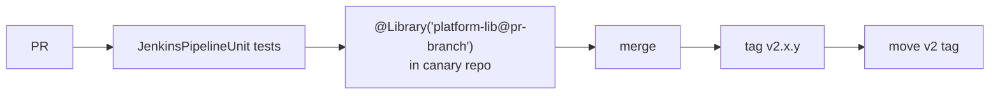

# Step 09 · Shared Library Golden Pipeline

[← GitHub + seed](08-github-seed-jobs.md) · [Next: DevSecOps →](10-devsecops.md)

---

## 1. Publish the library

```bash
cd platform-lib          # copied from 03-templates/shared-library in step 01
git add . && git commit -m "feat: golden pipeline v2" && git tag v2.0.0 && git push --tags origin main
git tag -f v2 && git push -f origin v2      # moving major tag consumers pin to
```

Registered globally via JCasC `unclassified.globalLibraries` (`defaultVersion: v2`).

## 2. CI images used by the pod templates

Build `ci/java21-build` and `ci/node20-build` images (tools: make, git, trivy, gitleaks, syft, cosign, crane, sonar-scanner, yq) in a `ci-images` repo, rebuilt weekly, scanned, pushed to ECR. Pods reference them by date tag.

## 3. App repo contract

| File | Purpose |
|------|---------|
| `Jenkinsfile` | 2 lines (below) |
| `Makefile` with `ci` target | Build + unit tests, JUnit XML in `reports/` |
| `Dockerfile` | Multi-stage, non-root |
| `sonar-project.properties` | Sonar key + paths |

```groovy
@Library('platform-lib@v2') _
goldenPipeline(language: 'java', image: 'payments-api', deploy: true)
```

## 4. Release process for the library



Breaking change → `v3` + migration guide; keep `v2` working until all repos move.

✅ Done when: a sample repo builds green with the 2-line Jenkinsfile.
