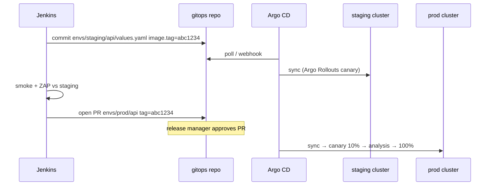

# Step 11 · GitOps CD with Argo CD

[← DevSecOps](10-devsecops.md) · [Next: Monitoring →](12-monitoring.md)

---

Jenkins = CI (build, test, scan, sign, bump tag). Argo CD = CD (sync Git → clusters). Jenkins holds **no** workload cluster credentials.



## 1. Install Argo CD

```bash
helm upgrade --install argocd argo-cd -n argocd --create-namespace --repo https://argoproj.github.io/argo-helm
argocd cluster add staging-context --name staging
argocd cluster add prod-context    --name prod
kubectl apply -f k8s/argocd-app.yaml        # ApplicationSet from 04-mega-setup/config
```

## 2. gitops repo layout

```text
gitops/
└── envs/
    ├── staging/
    │   └── api/values.yaml       # image.tag bumped by Jenkins (direct commit)
    └── prod/
        └── api/values.yaml       # bumped via PR, CODEOWNERS = release-managers
```

## 3. Jenkins side

- Deploy key `gitops-deploy-key` (write) via ESO + kubernetes-credentials-provider.
- `gitopsPromote(app:, tag:, env: 'staging')` from the shared library on `main` builds.
- Prod: [Jenkinsfile.gitops-promote](../../03-templates/jenkinsfiles/Jenkinsfile.gitops-promote) with `ENV=prod` opens a PR.

## 4. Progressive delivery

Argo Rollouts in workload clusters; chart `service` renders a `Rollout` with canary steps + Prometheus `AnalysisTemplate` (5xx rate < 1%, p95 < SLO). Failed analysis = automatic rollback, no human needed.

## 5. Rollback

`git revert` the promote commit → Argo syncs previous tag. Or Argo UI rollback (then fix Git to match).

✅ Done when: merge to app `main` → new version live in staging with no manual step; prod promote is a reviewed PR.
