# DevSecOps in Jenkins

> Security checks as pipeline stages. Shift left, fail on what matters, report the rest.

[← README](../README.md) · [Trivy](trivy.md) · [SonarQube](sonarqube.md) · [OWASP](owasp.md)

---

## 1. Scan types (know the acronyms)

| Acronym | Means | Finds | Tools |
|---------|-------|-------|-------|
| **SAST** | Static Application Security Testing | Bugs/vulns in your source code | SonarQube, Semgrep, CodeQL, Checkmarx |
| **SCA** | Software Composition Analysis | Known CVEs + licenses in dependencies | OWASP Dependency-Check, Trivy, Snyk, Grype, Dependabot |
| **Secrets scanning** | — | Hardcoded keys/tokens | gitleaks, trufflehog, GitHub secret scanning |
| **IaC scanning** | — | Misconfig in Terraform/K8s/Dockerfile | Trivy config, Checkov, tfsec (now in Trivy), kube-linter |
| **Container scanning** | — | OS + library CVEs in images | Trivy, Grype, Clair, ECR/Harbor built-in |
| **DAST** | Dynamic AST | Vulns in the *running* app (black-box) | OWASP ZAP, Burp |
| **IAST / RASP** | Interactive / Runtime self-protection | Instrumented app detects attacks | Contrast |
| **SBOM** | Software Bill of Materials | Inventory of components (SPDX / CycloneDX) | syft, trivy, cdxgen |
| **Signing / provenance** | — | Proves who built what, from which source | cosign (Sigstore), SLSA, in-toto |

## 2. Where each runs

```mermaid
---
config:
  look: handDrawn
---
flowchart LR
    C[Commit] --> S1[Secrets scan<br/>gitleaks]
    S1 --> S2[SAST<br/>SonarQube]
    S2 --> S3[SCA<br/>OWASP DC / Trivy fs]
    S3 --> S4[IaC scan<br/>Trivy config]
    S4 --> B[Build image]
    B --> S5[Image scan + SBOM<br/>Trivy image]
    S5 --> SIGN[Sign<br/>cosign]
    SIGN --> D[Deploy staging]
    D --> S6[DAST<br/>OWASP ZAP]
    S6 --> P[Prod]
    P --> R[Runtime: Falco,<br/>admission policy, continuous scan]
```



## 3. Policy: what fails the build

| Check | Fail | Warn (report) |
|-------|------|---------------|
| Secrets | Any | — |
| SAST (Sonar) | Quality Gate failed on new code | Existing debt |
| SCA | CRITICAL (or CVSS ≥ 9) with fix | HIGH, no fix |
| Image | CRITICAL fixable (`--ignore-unfixed`) | HIGH |
| IaC | HIGH/CRITICAL misconfig | MEDIUM |
| DAST | High alerts | Medium/low |

- Suppressions in versioned files (`.trivyignore`, `dependency-check-suppressions.xml`) with reason + expiry.
- Don't fail on everything on day 1 → teams disable scans. Start **report-only**, then ratchet.

## 4. Full DevSecOps stage block (copy-paste)

See [templates/jenkinsfiles/Jenkinsfile.devsecops](../03-templates/jenkinsfiles/Jenkinsfile.devsecops).

```groovy
stage('Security') {
  parallel {
    stage('Secrets') { steps { sh 'gitleaks detect --source . --no-banner --redact --report-format sarif --report-path gitleaks.sarif' } }
    stage('SAST')    { steps { withSonarQubeEnv('sonar') { sh 'sonar-scanner' } } }
    stage('SCA')     { steps { sh 'trivy fs --scanners vuln,license --severity HIGH,CRITICAL --exit-code 1 --ignore-unfixed .' } }
    stage('IaC')     { steps { sh 'trivy config --severity HIGH,CRITICAL --exit-code 1 .' } }
  }
}
stage('Quality Gate') { steps { timeout(time: 10, unit: 'MINUTES') { waitForQualityGate abortPipeline: true } } }
```

## 5. Supply chain security in one paragraph

Pin everything (base image digests, actions/plugins, deps lockfiles) → build in ephemeral isolated agents → generate SBOM → scan → sign image and attest SBOM + provenance (SLSA) → registry only accepts from CI → cluster admission (Kyverno / Sigstore policy-controller) only runs signed images from trusted registry → continuous re-scan of deployed images for new CVEs.
