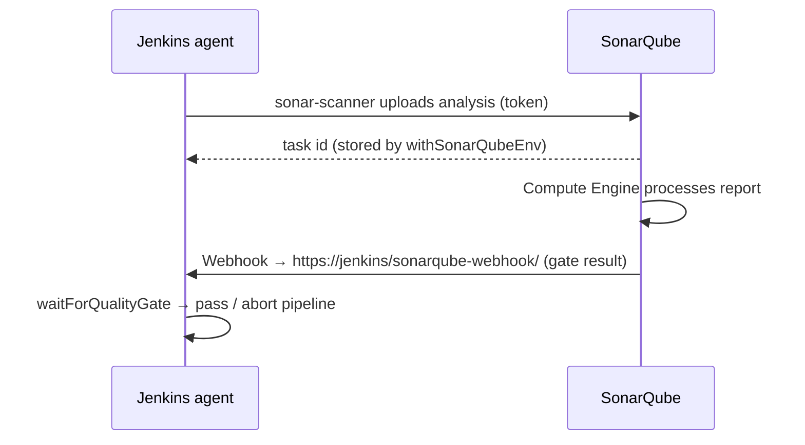

# SonarQube

> Code quality + SAST platform. Analyzes code, stores results, enforces a **Quality Gate**.

[← DevSecOps](README.md)

---

## 1. Concepts

| Term | Means |
|------|-------|
| **SonarQube Server** | Self-hosted (Community Build free; Developer/Enterprise paid: branch/PR analysis, more languages) |
| **SonarQube Cloud** (ex-SonarCloud) | SaaS |
| **Scanner** | CLI (`sonar-scanner`), Maven/Gradle plugin, .NET scanner — runs on agent, uploads report |
| **Compute Engine** | Server-side background task that processes the report |
| **Quality Profile** | Set of rules per language |
| **Quality Gate** | Pass/fail conditions (e.g. new coverage ≥ 80%, 0 new bugs/vulns, hotspots reviewed) |
| **Issues** | Bug, Vulnerability, Code Smell (+ Security Hotspot = needs human review) |
| **New Code period** | Since previous version / N days / reference branch — gate applies here ("Clean as You Code") |
| **Technical debt** | Estimated time to fix smells |
| **Ratings** | A–E for reliability, security, maintainability |

## 2. Flow with Jenkins



**Webhook in SonarQube is required** for `waitForQualityGate` (Administration → Configuration → Webhooks → `https://jenkins.example.com/sonarqube-webhook/`).

## 3. Quick setup (Docker)

```yaml
# compose.yaml
services:
  sonarqube:
    image: sonarqube:lts-community        # check current LTA/community tag
    ports: ["9000:9000"]
    environment:
      SONAR_JDBC_URL: jdbc:postgresql://db:5432/sonar
      SONAR_JDBC_USERNAME: sonar
      SONAR_JDBC_PASSWORD: sonar
    volumes: [sonar_data:/opt/sonarqube/data, sonar_ext:/opt/sonarqube/extensions]
    depends_on: [db]
  db:
    image: postgres:16
    environment: { POSTGRES_USER: sonar, POSTGRES_PASSWORD: sonar, POSTGRES_DB: sonar }
    volumes: [pg:/var/lib/postgresql/data]
volumes: { sonar_data: {}, sonar_ext: {}, pg: {} }
```

```bash
sudo sysctl -w vm.max_map_count=524288    # Elasticsearch inside SonarQube needs this
docker compose up -d                       # http://localhost:9000  admin/admin → change
```

Then:
1. My Account → Security → generate **token**.
2. Jenkins: credential *Secret text* `sonar-token`.
3. Manage Jenkins → System → **SonarQube servers**: name `sonar`, URL, token.
4. Manage Jenkins → Tools → **SonarQube Scanner** installation (or use scanner image).
5. SonarQube webhook → Jenkins.

## 4. Pipeline

```groovy
stage('SonarQube') {
  steps {
    withSonarQubeEnv('sonar') {                       // injects SONAR_HOST_URL + token
      sh '''
        sonar-scanner \
          -Dsonar.projectKey=payments-api \
          -Dsonar.sources=src \
          -Dsonar.tests=test \
          -Dsonar.javascript.lcov.reportPaths=coverage/lcov.info
      '''
      // Maven: sh 'mvn -B sonar:sonar'
      // Gradle: sh './gradlew sonar'
    }
  }
}
stage('Quality Gate') {
  steps { timeout(time: 10, unit: 'MINUTES') { waitForQualityGate abortPipeline: true } }
}
```

`sonar-project.properties` in repo root instead of `-D` flags:

```properties
sonar.projectKey=payments-api
sonar.sources=src
sonar.exclusions=**/generated/**
sonar.coverage.jacoco.xmlReportPaths=target/site/jacoco/jacoco.xml
```

PR decoration (Developer+): `-Dsonar.pullrequest.key=${CHANGE_ID} -Dsonar.pullrequest.branch=${CHANGE_BRANCH} -Dsonar.pullrequest.base=${CHANGE_TARGET}` (branch plugin auto-detects in multibranch).

## 5. Interview one-liners
- **Quality gate vs profile?** Profile = which rules. Gate = pass/fail thresholds.
- **Why the webhook?** Analysis is async; webhook tells Jenkins the result without polling.
- **Coverage shows 0%?** Sonar doesn't run tests — generate coverage report first and point `reportPaths` to it.
- **Hotspot vs vulnerability?** Hotspot = security-sensitive code needing review; vulnerability = confirmed issue.
