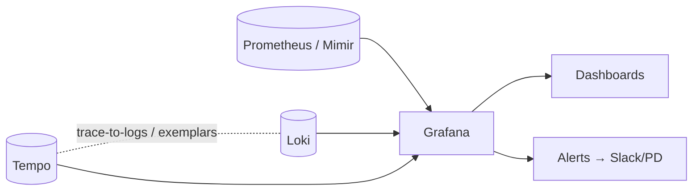

# Grafana

> Visualization + dashboards + alerting UI over many data sources (Prometheus, Loki, Tempo, Elasticsearch, CloudWatch, SQL).

[← Prometheus](prometheus.md) · [README →](../README.md)

---

## 1. Concepts

| Term | Means |
|------|-------|
| **Data source** | Backend Grafana queries (Prometheus, Loki, Tempo, Mimir...) |
| **Dashboard** | JSON document of panels; versioned |
| **Panel** | One visualization (time series, stat, gauge, table, heatmap, logs) |
| **Variables** | Dropdowns (`$job`, `$namespace`) templating queries: `label_values(up, job)` |
| **Annotations** | Events on graphs (deploys!) |
| **Provisioning** | Data sources + dashboards from YAML/JSON files at startup ⭐ as code |
| **Grafana Alerting** | Unified alerting: rules, contact points, notification policies |
| **Folders + RBAC** | Permissions per team |
| **LGTM stack** | **L**oki (logs), **G**rafana, **T**empo (traces), **M**imir (metrics) |



## 2. Quick setup

```yaml
# compose excerpt
grafana:
  image: grafana/grafana:11.3.0
  ports: ["3000:3000"]
  environment:
    GF_SECURITY_ADMIN_PASSWORD__FILE: /run/secrets/grafana_admin
    GF_USERS_ALLOW_SIGN_UP: "false"
  volumes:
    - ./grafana/provisioning:/etc/grafana/provisioning
    - grafana_data:/var/lib/grafana
```

```yaml
# grafana/provisioning/datasources/ds.yaml
apiVersion: 1
datasources:
  - name: Prometheus
    type: prometheus
    url: http://prometheus:9090
    isDefault: true
  - name: Loki
    type: loki
    url: http://loki:3100
```

```yaml
# grafana/provisioning/dashboards/dash.yaml
apiVersion: 1
providers:
  - name: default
    folder: CI
    type: file
    options: { path: /etc/grafana/provisioning/dashboards/json }
```

Drop exported dashboard JSON into `dashboards/json/`. Import community dashboards by ID: Dashboards → New → Import (e.g. Node Exporter Full **1860**, Jenkins **9964**).

## 3. Jenkins dashboard queries

| Panel | PromQL |
|-------|--------|
| Queue | `jenkins_queue_size_value` |
| Executors busy % | `100 * jenkins_executor_in_use_value / jenkins_executor_count_value` |
| Agents offline | `jenkins_node_offline_value` |
| Heap % | `jvm_memory_bytes_used{area="heap",job="jenkins"} / jvm_memory_bytes_max{area="heap",job="jenkins"}` |
| Build duration p95 (job var) | `default_jenkins_builds_duration_milliseconds_summary{jenkins_job=~"$job",quantile="0.95"}` |
| Last result per job (table) | `default_jenkins_builds_last_build_result_ordinal` |

Deploy annotations: pipeline posts to Grafana API after deploy:

```bash
curl -s -X POST -H "Authorization: Bearer $GRAFANA_TOKEN" -H 'Content-Type: application/json' \
  "$GRAFANA_URL/api/annotations" \
  -d "{\"tags\":[\"deploy\",\"api\"],\"text\":\"api ${TAG} → prod (build ${BUILD_NUMBER})\"}"
```

## 4. Good dashboard rules
- Top row = SLO/health stats; then traffic, errors, latency, saturation.
- One dashboard per service + one overview. Variables instead of copies.
- Units + thresholds set; y-axis from 0 for rates.
- Dashboards as code (provisioning, Grafonnet/Jsonnet, Terraform grafana provider).
- Alert on symptoms (SLO burn rate), dashboards for diagnosis.
