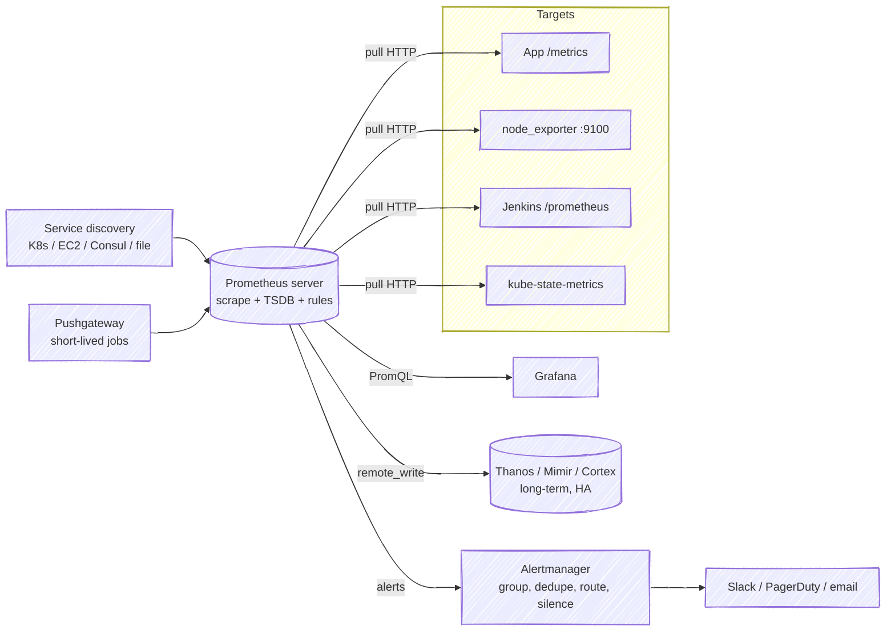

# Prometheus

> Pull-based metrics system + time-series DB + alerting rules. CNCF graduated.

[← README](../README.md) · [Grafana →](grafana.md)

---

## 1. Architecture



## 2. Concepts

| Term | Means |
|------|-------|
| **Pull model** | Prometheus scrapes `/metrics` endpoints every `scrape_interval` |
| **Target / Job** | Endpoint / group of endpoints with same purpose |
| **Exporter** | Adapter exposing metrics for 3rd-party systems (node, blackbox, mysqld, redis) |
| **Time series** | metric name + unique label set → stream of (timestamp, value) |
| **Labels** | Key/value dimensions (`method="GET"`). **High cardinality** (user IDs, URLs) kills Prometheus |
| **Metric types** | **Counter** (only up, reset on restart), **Gauge** (up/down), **Histogram** (buckets, server-side quantiles via `histogram_quantile`), **Summary** (client-side quantiles, not aggregatable) |
| **Recording rule** | Precompute expensive query into new series |
| **Alerting rule** | PromQL condition + `for` duration → alert |
| **Alertmanager** | Grouping, inhibition, silences, routing |
| **Pushgateway** | For batch jobs that can't be scraped (not for regular services) |
| **Retention** | Local TSDB default 15d; long-term = Thanos/Mimir/remote storage |
| **Federation** | Prometheus scraping another Prometheus |
| **kube-prometheus-stack** | Helm chart: Prometheus Operator + Prometheus + Alertmanager + Grafana + exporters ⭐ |
| **ServiceMonitor / PodMonitor** | Operator CRDs: declare what to scrape |

## 3. PromQL essentials

```promql
up                                                     # 1 = target up
rate(http_requests_total[5m])                          # per-second rate of counter
sum by (status) (rate(http_requests_total[5m]))        # aggregate by label
sum(rate(http_requests_total{code=~"5.."}[5m])) / sum(rate(http_requests_total[5m]))   # error ratio
histogram_quantile(0.95, sum by (le) (rate(http_request_duration_seconds_bucket[5m]))) # p95 latency
increase(jenkins_builds_failed_total[1h])              # count in window
avg_over_time(node_load1[10m])
topk(5, sum by (pod) (rate(container_cpu_usage_seconds_total[5m])))
100 * (1 - node_memory_MemAvailable_bytes / node_memory_MemTotal_bytes)              # mem %
predict_linear(node_filesystem_avail_bytes[6h], 4*3600) < 0                           # disk full in 4h
absent(up{job="jenkins"})                              # alert when series missing
```

- `rate()` for counters only; `irate()` = last two points (spiky).
- Always `rate` **then** `sum` (not sum then rate).
- Golden signals: **latency, traffic, errors, saturation**. RED (Rate, Errors, Duration) for services; USE (Utilization, Saturation, Errors) for resources.

## 4. Quick setup (Docker Compose)

Ready file: [templates/monitoring/compose.monitoring.yaml](../03-templates/monitoring/compose.monitoring.yaml).

```yaml
# prometheus.yml
global:
  scrape_interval: 15s
  evaluation_interval: 15s
rule_files: [/etc/prometheus/rules/*.yml]
alerting:
  alertmanagers: [{ static_configs: [{ targets: ['alertmanager:9093'] }] }]
scrape_configs:
  - job_name: prometheus
    static_configs: [{ targets: ['localhost:9090'] }]
  - job_name: node
    static_configs: [{ targets: ['node-exporter:9100'] }]
  - job_name: jenkins
    metrics_path: /prometheus/
    static_configs: [{ targets: ['jenkins:8080'] }]
```

```bash
docker compose -f compose.monitoring.yaml up -d
# Prometheus http://localhost:9090  → Status → Targets (all UP?)
curl -s localhost:9090/api/v1/query --data-urlencode 'query=up' | jq
promtool check config prometheus.yml
promtool check rules rules/*.yml
curl -X POST localhost:9090/-/reload     # needs --web.enable-lifecycle
```

## 5. Kubernetes setup

```bash
helm repo add prometheus-community https://prometheus-community.github.io/helm-charts
helm upgrade --install kps prometheus-community/kube-prometheus-stack -n monitoring --create-namespace
kubectl -n monitoring port-forward svc/kps-grafana 3000:80
```

```yaml
apiVersion: monitoring.coreos.com/v1
kind: ServiceMonitor
metadata: { name: jenkins, namespace: monitoring, labels: { release: kps } }
spec:
  namespaceSelector: { matchNames: [jenkins] }
  selector: { matchLabels: { app.kubernetes.io/name: jenkins } }
  endpoints: [{ port: http, path: /prometheus/, interval: 30s }]
```

## 6. Alertmanager routing sketch

```yaml
route:
  receiver: slack-default
  group_by: [alertname, job]
  group_wait: 30s
  group_interval: 5m
  repeat_interval: 4h
  routes:
    - matchers: [severity="critical"]
      receiver: pagerduty
receivers:
  - name: slack-default
    slack_configs: [{ api_url_file: /etc/am/slack-url, channel: '#alerts', send_resolved: true }]
  - name: pagerduty
    pagerduty_configs: [{ routing_key_file: /etc/am/pd-key }]
inhibit_rules:
  - source_matchers: [severity="critical"]
    target_matchers: [severity="warning"]
    equal: [alertname, job]
```

## 7. Interview one-liners
- **Pull vs push?** Pull: Prometheus controls rate, easy up/down detection, targets simple. Push (Pushgateway, OTLP) for short-lived jobs / firewalled sources.
- **Counter vs gauge?** Counter only increases (requests total) → use `rate`. Gauge goes both ways (memory).
- **Histogram vs summary?** Histogram aggregatable across instances; summary quantiles can't be aggregated.
- **Scale Prometheus?** Shard by function, federation, remote_write to Thanos/Mimir; control cardinality.
