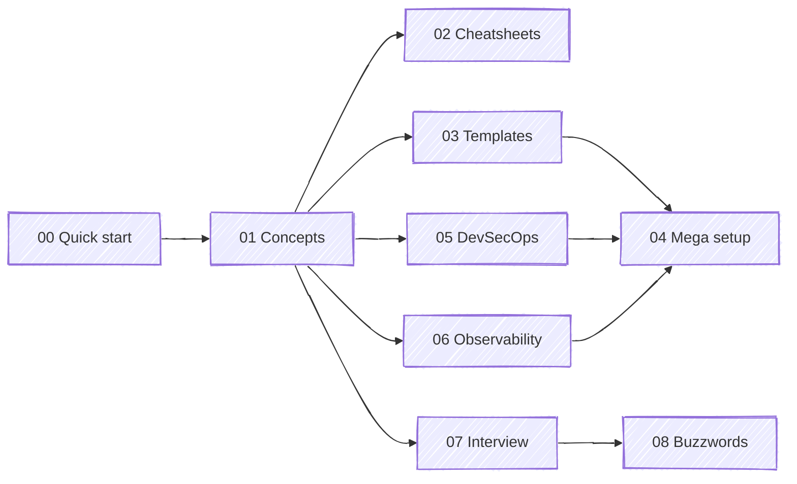

# Jenkins Vault

> My go-to Jenkins + CI/CD reference: learn it, set it up for any project, revise before SRE/DevOps interviews. Concise, structured, no filler.

-D24939?logo=jenkins&logoColor=white)


Sister vaults: [docker-vault](https://github.com/vinitpatil519/docker-vault) · [kubernetes-vault](https://github.com/vinitpatil519/kubernetes-vault)

---

## Use it by goal

| I want to… | Go to |
|------------|-------|
| Get Jenkins running now | [00-quick-start](00-quick-start/README.md): lab in 5 min, any project in 10 |
| Learn Jenkins + CI/CD properly | [01-concepts](#01-concepts) in order |
| Find a command / syntax fast | [02-cheatsheets](02-cheatsheets/) |
| Copy a Jenkinsfile / config | [03-templates](03-templates/README.md) |
| Build a production Jenkins platform | [04-mega-setup](04-mega-setup/README.md) |
| Add security scanning | [05-devsecops](05-devsecops/README.md) |
| Add monitoring | [06-observability](06-observability/prometheus.md) |
| Prep for an interview tonight | [07-interview](07-interview/README.md) |
| Decode a word a senior engineer used | [08-buzz-words](08-buzz-words/README.md) |
| Revise from pictures | [diagrams](diagrams/README.md) |

## Map



---

## 01-concepts

| # | Chapter | You leave knowing |
|---|---------|-------------------|
| 01 | [CI/CD fundamentals](01-concepts/01-cicd-fundamentals.md) | CI vs CD vs CD, pipeline anatomy, branching, versioning, DORA |
| 02 | [Architecture](01-concepts/02-architecture.md) | Controller, agents, executors, remoting, JENKINS_HOME, build flow |
| 03 | [Installation](01-concepts/03-installation.md) | Docker, apt, Helm, WAR, reverse proxy, first-boot checklist |
| 04 | [Jobs & builds](01-concepts/04-jobs-and-builds.md) | Job types, triggers, webhooks, cron `H`, parameters, results |
| 05 | [Declarative pipeline](01-concepts/05-pipeline-declarative.md) | Every directive, `when`, `post`, `input`, parallel, matrix, steps |
| 06 | [Scripted & Groovy](01-concepts/06-pipeline-scripted-groovy.md) | Scripted, Groovy essentials, CPS, `@NonCPS`, sandbox |
| 07 | [Shared libraries](01-concepts/07-shared-libraries.md) | `vars/src/resources`, trust, versioning, golden pipeline |
| 08 | [Agents](01-concepts/08-agents-distributed-builds.md) | SSH, inbound, Docker, Kubernetes plugin, labels, workspaces |
| 09 | [Credentials & secrets](01-concepts/09-credentials-secrets.md) | Types, scopes, masking, Vault/ESO, OIDC |
| 10 | [Security](01-concepts/10-security.md) | Threat model, SSO, RBAC, hardening, pipeline security |
| 11 | [JCasC & Job DSL](01-concepts/11-jcasc-job-dsl.md) | Zero-click Jenkins from Git |
| 12 | [Plugins](01-concepts/12-plugins.md) | Essential plugins, pinning, upgrades |
| 13 | [SCM & integrations](01-concepts/13-scm-webhooks-integrations.md) | GitHub App, webhooks, monorepos, notifications |
| 14 | [Artifacts & caching](01-concepts/14-artifacts-caching.md) | Repos, promotion, caching, speed checklist |
| 15 | [Testing & quality gates](01-concepts/15-testing-quality-gates.md) | Test pyramid, reports, gates, flaky tests |
| 16 | [Docker & K8s CI/CD](01-concepts/16-docker-kubernetes-cicd.md) | Rootless builds, signing, push vs GitOps, Helm |
| 17 | [Deployment strategies](01-concepts/17-deployment-strategies.md) | Rolling, blue/green, canary, flags, rollback, DB migrations |
| 18 | [Scaling & HA](01-concepts/18-scaling-ha-performance.md) | Sharding, HA options, tuning, capacity |
| 19 | [Backup, DR, upgrades](01-concepts/19-backup-dr-upgrades.md) | What to back up, DR plan, upgrade runbook |
| 20 | [Monitoring Jenkins](01-concepts/20-monitoring-jenkins.md) | Verified metric names, alerts, dashboards |
| 21 | [Troubleshooting](01-concepts/21-troubleshooting.md) | Error → cause → fix table, debug tools |
| 22 | [Jenkins vs others](01-concepts/22-jenkins-vs-others.md) | GHA, GitLab CI, Tekton, Argo CD; concept mapping |

## Other sections

| Section | Contents |
|---------|----------|
| [02-cheatsheets](02-cheatsheets/) | [Jenkins ops](02-cheatsheets/jenkins-cheatsheet.md) (URLs, REST, CLI, Script Console) · [Pipeline syntax](02-cheatsheets/pipeline-syntax.md) · [DevSecOps + observability](02-cheatsheets/devsecops-observability-cheatsheet.md) |
| [03-templates](03-templates/README.md) | Runnable Docker lab, 11 Jenkinsfiles, shared library, production JCasC, Job DSL seed, K8s agent manifests, monitoring configs |
| [04-mega-setup](04-mega-setup/README.md) | 14 steps: EKS + Helm + JCasC + SSO + K8s agents + GitHub App + golden pipeline + DevSecOps + Argo CD + monitoring + DR |
| [05-devsecops](05-devsecops/README.md) | [Trivy](05-devsecops/trivy.md) · [SonarQube](05-devsecops/sonarqube.md) · [OWASP Top 10 / Dependency-Check / ZAP](05-devsecops/owasp.md) |
| [06-observability](06-observability/prometheus.md) | [Prometheus](06-observability/prometheus.md) · [Grafana](06-observability/grafana.md) |
| [07-interview](07-interview/README.md) | 100 Jenkins Q&A · 52 CI/CD/DevSecOps/SRE Q&A · 20 scenarios · 60-second pitch |
| [08-buzz-words](08-buzz-words/README.md) | ~600 terms across 14 domains: DevOps, cloud, K8s, networking, backend, APIs, DBs, distributed systems, security, SRE, performance, Linux, data/AI, org |
| [diagrams](diagrams/README.md) | 15 revision diagrams |

## Repository structure

```text
jenkins-vault/
├── 00-quick-start/        lab in 5 min, any project in 10
├── 01-concepts/           22 chapters
├── 02-cheatsheets/        ops · pipeline syntax · devsecops/observability
├── 03-templates/
│   ├── docker/            runnable lab (compose, Dockerfile, plugins, JCasC, seed)
│   ├── jenkinsfiles/      java · node · python · go · docker · devsecops · helm · gitops · terraform · monorepo · matrix · scripted
│   ├── shared-library/    platform-lib (vars, src, resources)
│   ├── jcasc/             production jenkins.yaml
│   ├── job-dsl/           seed.groovy
│   ├── k8s/               agent namespace, PVCs, pod templates
│   └── monitoring/        prometheus.yml, alerts, Grafana provisioning
├── 04-mega-setup/         README + steps/01–14 + config/
├── 05-devsecops/          trivy · sonarqube · owasp
├── 06-observability/      prometheus · grafana
├── 07-interview/          Q&A + scenarios
├── 08-buzz-words/         14 domain glossaries
└── diagrams/              revision atlas
```

## Verified

The lab in `03-templates/docker` was booted and exercised: JCasC applied with no errors, SSH agent online, seed jobs created, demo pipeline green, Prometheus scraping Jenkins, alert rules loaded, Grafana dashboard provisioned. The production image (`04-mega-setup/config`) with the production JCasC (`03-templates/jcasc`) was also boot-tested with dummy secrets: config applied, seed job created. Jenkins metric names in chapter 20 come from the live instance.
