# Diagram Atlas

> Every key picture in one place, for whiteboard revision. Hand-drawn (Miro-style) look where GitHub's Mermaid supports it; plain Mermaid elsewhere.

[← README](../README.md)

---

## 1. Jenkins architecture

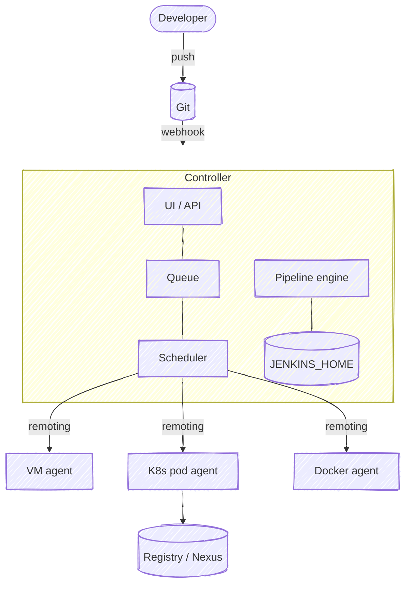

## 2. Build lifecycle

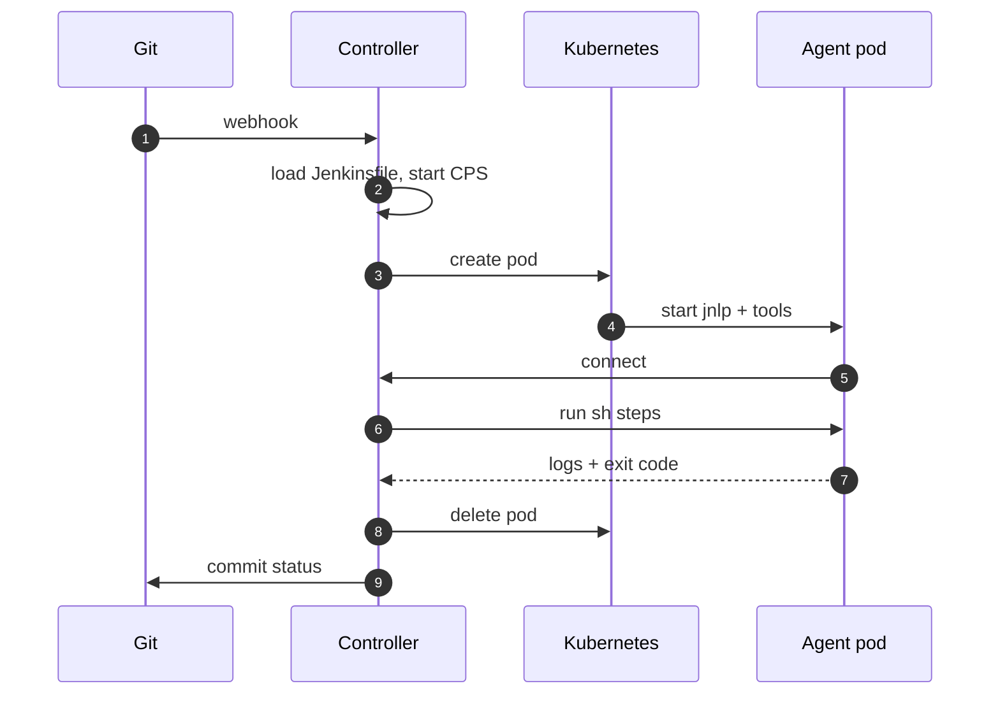

## 3. CI/CD flow (end to end)

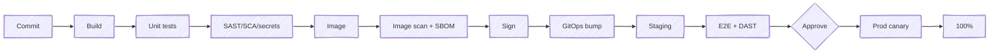

## 4. Agent types

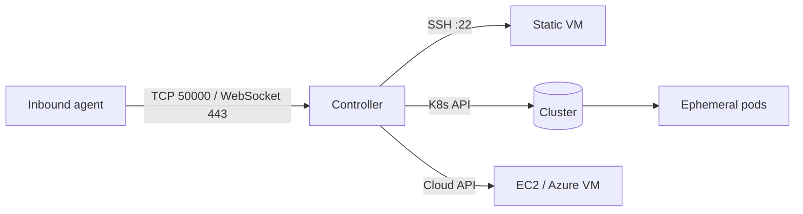

## 5. Everything as code

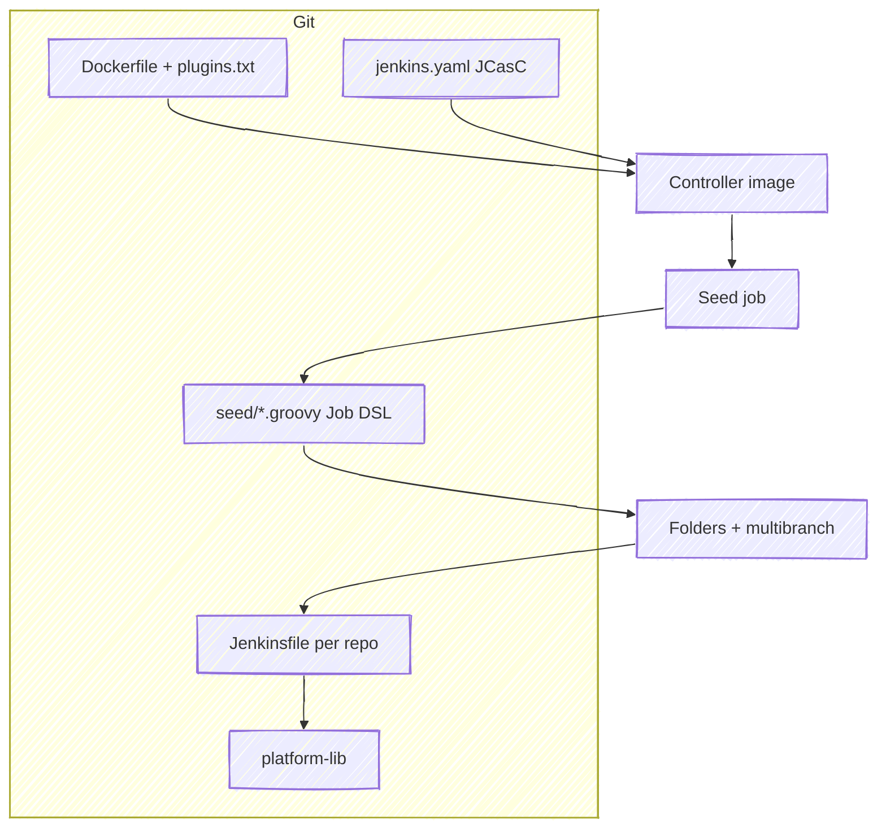

## 6. Credentials flow

```mermaid
flowchart LR
    V[(Vault / AWS SM)] -->|ESO| KS[K8s Secret] -->|env| C[Controller]
    C -->|JCasC ${VAR}| CR[Credential store]
    CR -->|withCredentials| P[Step]
    SA[Agent SA] -->|IRSA / OIDC| AWS[(Cloud APIs, no keys)]
```

## 7. Security layers

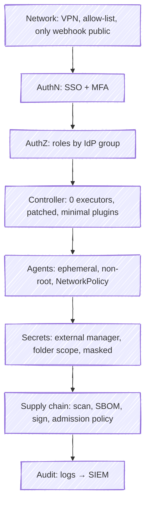

## 8. Push vs GitOps deploy

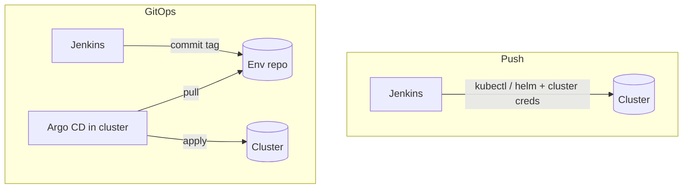

## 9. Deployment strategies

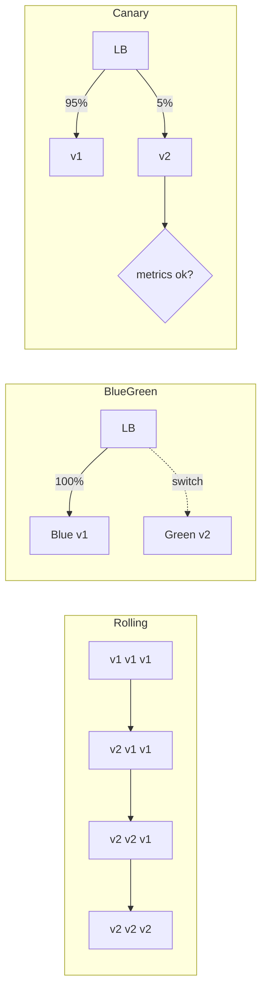

## 10. DevSecOps gates

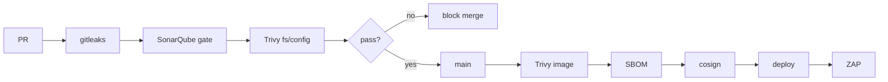

## 11. Monitoring stack

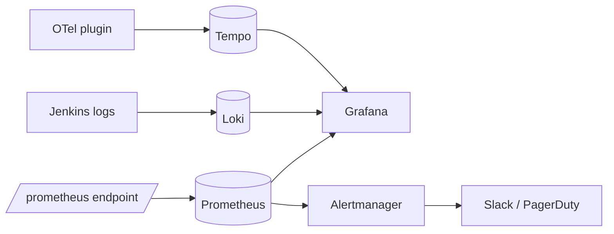

## 12. Scaling: shard controllers, share agents

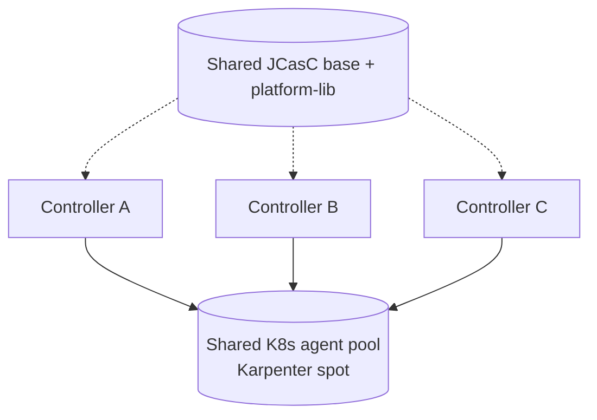

## 13. Backup & DR

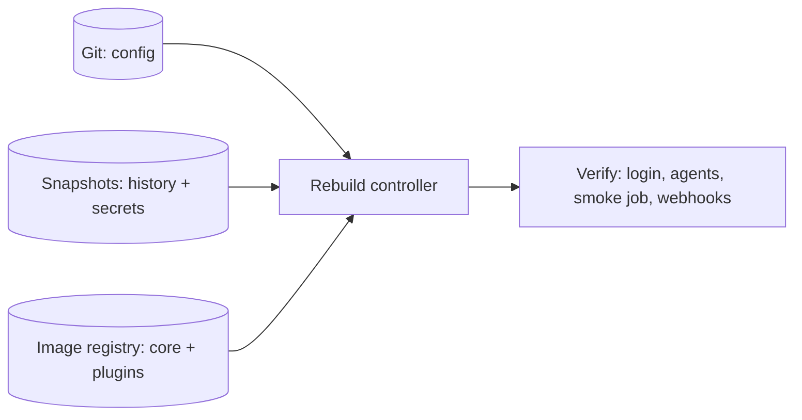

## 14. Pipeline anatomy (declarative)

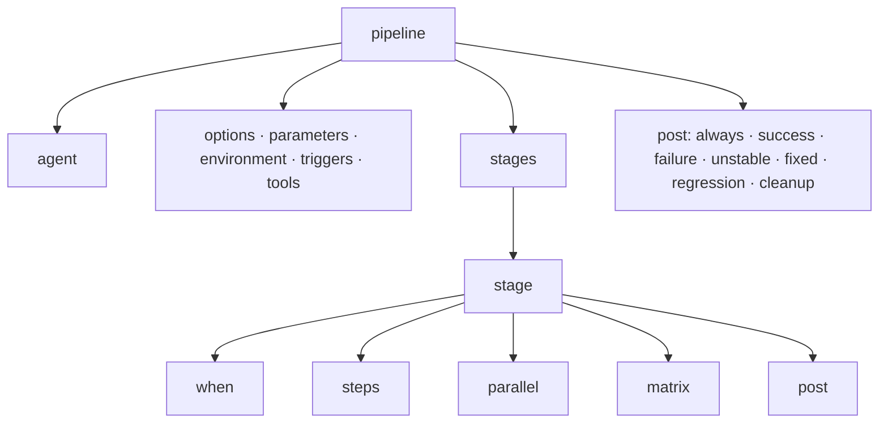

## 15. Mega setup

See [04-mega-setup/README.md](../04-mega-setup/README.md#1-target-architecture) for the full platform diagram.
